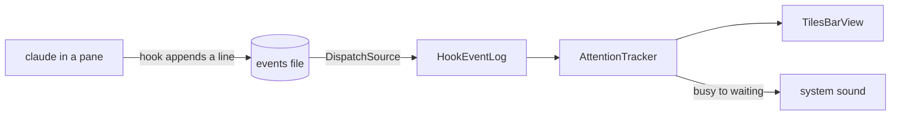

# Architecture

Claudeshell is a native Mac app that shows every Claude Code project as a tile: its icon with the name below it. The app finds the icons itself; a project without one shows its initials on its colour. A tile shows whether Claude is busy or waits for HP, and a click or shortcut opens the project with a shell on the left and Claude on the right. Below the tiles bar a strip shows the links, the git state, the workflow step and an AI summary of the selected project.

## Two targets

The project is a Swift package (`Package.swift`, swift-tools 6.2, Swift 6 language mode, macOS 14+). There is no Xcode project.

| Target | Role | Tests |
|---|---|---|
| `ClaudeshellCore` | All logic without UI | `swift test`, Swift Testing |
| `Claudeshell` | The AppKit and SwiftUI app, on top of SwiftTerm `1.99.3` (exact pin) | Checked by hand in the built app |

`scripts/build-app.sh` builds the release binary, puts it with `Support/Info.plist` and `Support/Fonts/` in `build/Claudeshell.app` and signs it ad hoc. `./runlocal.sh` builds and opens the app. `scripts/install-app.sh` builds and copies the app to `/Applications/Claudeshell.app`, which is what the Dock icon starts.

The icon is drawn by `scripts/make-icon.swift`; `Support/AppIcon.icns` is its output in all icon sizes.

### ClaudeshellCore

| File | What it holds |
|---|---|
| `Project.swift` | Shared types: `Project` with its initials, `ProjectStatus`, `IconState`, `PaneID`, `PaneKind`, `AttentionState`, and the start frame of the window |
| `ProjectStore.swift` | The project list, the alphabetical bar order, status per project, selection, and storage |
| `ColorPalette.swift` | 16 fixed pastel tile colours and the choice of the next free one |
| `IconFinder.swift` | The candidate icon files in a project folder, best first |
| `DomainGuesser.swift` | The domains that are literally in a project: folder name, `CNAME`, `package.json`, `pyproject.toml`, `ALLOWED_HOSTS` |
| `FaviconLocator.swift` | The candidate favicon URLs of a web page, best first |
| `IconImage.swift` | Decodes an image, tells whether it is too wide, and makes the square PNG of 128 pixels |
| `IconResolver.swift` | One search round for a project, and the icon files in `icons/` |
| `WezTermImporter.swift` | Parser for the `projects` and `simple_projects` tables in `~/.wezterm.lua` |
| `HookSettings.swift` | Generates the Claude Code settings file with the hooks |
| `HookEventLog.swift` | Reads new lines from the events file |
| `Attention.swift` | `AttentionTracker`: state per pane, aggregate per project, next waiting project |
| `LaunchSpec.swift` | Program, arguments, environment and folder for a shell or Claude pane |
| `FuzzyMatcher.swift` | Scoring for the Cmd+P finder |
| `Subprocess.swift` | Starts a program and returns its output without blocking a thread; the injected `ProcessRunner` type |
| `GitState.swift` | Branch, changed files, unpushed commits and `HEAD` of a folder, and the web page of a remote |
| `LocalhostGuesser.swift` | The local address of a project, from the port in its `runlocal.sh` |
| `ProjectLinks.swift` | The live, localhost and git link: HP's own link per kind, else the one the app finds |
| `WorkflowStep.swift` | The step in the hp workflow, from `docs/` and the worktrees |
| `TranscriptReader.swift` | The last turns of the last Claude conversation of a project |
| `ProjectSummary.swift` | The summary file of a project and its fingerprint |
| `SummaryWriter.swift` | Decides whether a summary is needed, has `claude` write it and stores it |
| `SummaryQueue.swift` | The projects that wait for a summary, one at a time |
| `ProjectInfoStore.swift` | The memory of the strip: the data per project, open or closed, and the moments for a summary |

### Claudeshell

| File | What it holds |
|---|---|
| `main.swift`, `AppDelegate.swift` | Start-up: store, first-start import, hook settings, events watcher, sound, and the summary round |
| `MainWindowController.swift` | The window, the strip and the split with two slots, every user action, and the loop that keeps the strip fresh |
| `ProjectStripView.swift` | SwiftUI strip with the links, git state, workflow step and summary of the selected project |
| `TilesBarView.swift` | SwiftUI tiles bar with context menu, inactive dropdown and + |
| `IconStore.swift` | The loaded icon per project, the search rounds, and the icon actions of the context menu |
| `SessionManager.swift` | Starts, stops and restarts the panes of running projects |
| `TerminalPaneView.swift`, `TerminalTheme.swift` | A SwiftTerm view per pane with the bundled fonts; the shell pane has the dark WezTerm colours, the Claude pane a light palette |
| `QuickOpenPanel.swift` | The Cmd+P finder as a sheet |
| `MainMenu.swift` | All shortcuts as menu items |

## From hook to tile



1. `SessionManager` starts Claude through `zsh -lic` with the command in `LaunchSpec.claudeCommand`. The environment carries `CLAUDESHELL_PANE` (a new id for every start), `CLAUDESHELL_EVENTS` and `CLAUDESHELL_SETTINGS`.
2. Claude reads the hooks from `--settings "$CLAUDESHELL_SETTINGS"`. These are merged with the hooks in `~/.claude/settings.json`, which stays untouched.
3. Every hook is `echo "$CLAUDESHELL_PANE <state>" >> "$CLAUDESHELL_EVENTS"`.
4. `AppDelegate` watches the events file with a `DispatchSource` on the main queue and hands new lines to `AttentionTracker`.
5. The tracker is `@Observable`; the tiles bar redraws by itself. A pane that goes from busy to waiting plays the Glass sound.

A line with a pane id the tracker does not know is ignored. That covers late hooks of a stopped session.

### States

A registered pane starts idle. `busy` counts from any state. `waiting` counts only from busy. When HP leaves a project, its waiting panes become idle. A project shows waiting if one pane waits, otherwise busy if one is busy, otherwise idle.

### Hooks, as observed with Claude Code 2.1.319

| Hook | Matcher | State |
|---|---|---|
| `UserPromptSubmit` | none | busy |
| `PostToolUse` | none | busy |
| `Stop` | none | waiting |
| `PreToolUse` | `AskUserQuestion` | waiting |
| `PermissionRequest` | none | waiting |
| `Notification` | `idle_prompt\|agent_needs_input\|elicitation_dialog\|permission_prompt` | waiting |

What the check in a real interactive session showed:

- A plain prompt gives `UserPromptSubmit` and then `Stop`. `idle_prompt` follows 60 seconds after a `Stop`, never in a session that has had no prompt yet.
- `AskUserQuestion` gives `PreToolUse` and `PermissionRequest` at once, also with `--dangerously-skip-permissions`. Answering gives `PostToolUse`, which puts the pane back on busy.
- Plan approval (`ExitPlanMode`) gives `PermissionRequest` at once; the `permission_prompt` notification only comes 6 seconds later. That is why `PermissionRequest` is in the table.
- A background task that wakes Claude gives a new `UserPromptSubmit` and later a `Stop`.
- Tool calls of a background subagent also give `PostToolUse`, so the tile shows busy while the subagent works after the main turn ended.
- `/cost` and `/help` fire nothing. A prompt-type slash command fires `UserPromptSubmit`.
- `agent_needs_input` and `elicitation_dialog` are documented but were not observed.

Known gaps:

- **Escape during a turn fires no hook at all**, not even `idle_prompt` later. The tile stays busy until the next prompt in that pane.
- `/compact` fires `PreCompact` and `PostCompact` but none of the hooks above, so the tile does not show busy while compacting.
- The trust dialog of a folder Claude has not seen before fires no hooks.

### Resuming the last conversation

`claude --continue` exits with `No conversation found to continue` when the folder has no conversation yet. The command therefore falls back: `claude ... --continue ... || exec claude ...`. The fallback also runs when a resumed Claude exits with an error code.

The call that writes a summary (see Project strip) runs with `--no-session-persistence` in the support folder, so it leaves no conversation behind and `--continue` always resumes HP's own conversation.

## Icons

The icon of a project is one file, `icons/<project id>.png`: a square PNG of 128 pixels. A project has an icon when that file exists, so the bar works without network and without the source file.

`IconStore` loads the files at start and runs a search round for every project without `iconState`, also the inactive ones, and for a project that is added. A round runs off the main actor, rounds of different projects run side by side, and a tile shows initials until its icon is there. After a round `iconState` is `searched`, also without a hit, so the app searches once per project.

One round of `IconResolver` takes the first usable image in this order:

1. The favicon of the website that is filled in for the project.
2. The candidates of `IconFinder` in the project folder.
3. The favicon of a domain from `DomainGuesser`.

An image whose long side is more than one and a half times the short side, such as a wordmark, is skipped. A favicon comes from the `link` tags of the page, then from `/apple-touch-icon.png` and `/favicon.ico`. Only `http` and `https`, 10 seconds per request, at most 2 MB per file, no retries. A round without a hit leaves the existing file as it is.

The context menu of a tile corrects the result. An image HP chooses gives `custom`: it is stored whatever its shape and no round replaces it. 'Icoon weghalen' deletes the file and gives `removed`: the app does not search again by itself. 'Opnieuw zoeken' and a changed website start a new round, except for `custom`. Removing a project deletes its icon file.

## Project strip

The strip sits between the tiles bar and the split, 62 points high whatever it shows, so arriving data never moves the terminals. The summary stands first, on the left; a narrow column on the right holds the git state with a dot (green when clean and pushed, orange otherwise), the workflow step and the links. It opens when a project goes from active to running. Cmd+I, 'Beeld > Projectstrook' and the button on the right of the tiles bar close and open it per project; the closed set lives in memory only. Opening and closing swaps one constraint and never touches the focus.

All data lives in `ProjectInfoStore` per project id, so a late answer for one project never shows under another.

| Data | Source |
|---|---|
| Git link | `git remote get-url origin`, as `https://host/user/repo`; remotes with fewer than two path parts (Heroku, Dokku) give none |
| Live link | The `website` of the project, else the first domain of `DomainGuesser` |
| Localhost link | The port in `runlocal.sh`: `runserver N`, `http.server N`, `--port N`, then `localhost:N` and `127.0.0.1:N`; a variable is looked up in the script, then in `.env`, then its `:-` default |
| Git state | `git --no-optional-locks status --porcelain=v2 --branch`; without `--no-optional-locks` the status holds `index.lock` and a commit at that moment fails |
| Workflow step | The first that fits: an open task in `docs/handoff/README.md`, an extra worktree whose branch has commits `HEAD` misses (`fix/` is a bugfix), the newest `*-plan.md` that is not built, the newest requirements without a plan |
| Summary | `summaries/<project id>.json` |

A link HP sets or clears through the context menu of the strip is stored in `linkOverrides` and wins from then on; 'Links opnieuw zoeken' forgets them. A plan counts as built once a commit touches something outside `docs/`, the commit that added the plan included; commits whose message starts with `publish` do not count.

One loop keeps the strip fresh: a round, five seconds of waiting, again. It runs only for the selected project, with an open strip and the app in front, and starts again with a round right away on a selection, on opening the strip and when the app comes to the front. That follows a turn of Claude and what HP types in the shell without watching either.

### Summary

The summary is one or two Dutch sentences, written by the `claude` CLI on the account HP is logged in with:

```
claude -p --model haiku --safe-mode --no-session-persistence --tools "" --strict-mcp-config
       --disable-slash-commands --output-format json --system-prompt <instruction>
```

The material goes in on standard input: the last eight turns of the last conversation (HP's message and Claude's closing answer, 2000 characters each), the last 15 commits, the git state, and the first 4000 characters of the newest plan and of the handoff. The call runs in the support folder, never in the project folder, so no `CLAUDE.md`, hooks or MCP servers of a project are read. `claude` is expected at `~/.local/bin/claude`, else a login shell is asked once; git is `/usr/bin/git`.

Four moments bring a summary up to date: a project stops, the app starts (all projects in the bar), a project starts, and the refresh button. Every summary carries a fingerprint: the conversation file, the `uuid` of its last real message and the commit of `HEAD`. An equal fingerprint means no call; only the refresh button skips that check. A queue makes one summary at a time with a timeout of 60 seconds and no retries; a started or refreshed project goes to the front. A failure in the round at the start of the app ends that round. On a failure the old summary stays, the strip says 'Verversen lukte niet', and one line goes to the log category `Summary`. Quitting breaks off a running call without waiting.

### Conversation files, as observed with Claude Code 2.1.319

The conversations of a project are the `.jsonl` files directly in `~/.claude/projects/<folder>/`, where the folder is the real project path with every character outside letters and digits as a hyphen. This is not a public format; `TranscriptReader` keeps all names in one place and skips every line it does not understand.

- The last conversation is not the newest file: resuming without saying anything moves the modification time, and `/clear` starts a new, empty file. The reader takes the three newest files with `entrypoint` `cli` and picks the one whose last real message is the newest.
- A real message of HP is a `user` line without `isMeta`, `isCompactSummary` or a `tool_result` block, not a task notification, and not text that Claude Code wrapped itself (`<command-name>`, `<local-command-stdout>`, `<bash-input>` and the like). A real message of Claude is an `assistant` line with a text block, not `<synthetic>` and not an API error.
- A `system` line with subtype `away_summary` after the last real message is the interim summary Claude Code wrote itself; it goes along.
- Files run up to 20 MB with single lines over 1 MB. The reader goes backwards in blocks and decodes a line only when it holds `"type":"user"`, `"type":"assistant"` or `"subtype":"away_summary"` and not `"sourceToolAssistantUUID"`, which is in every tool result.

## Panes and sessions

- A project has a list of panes; version 1 always starts two (shell, Claude). `PaneID`, the tracker and `LaunchSpec` do not assume that number. Only `MainWindowController` has exactly two slots.
- Views of projects that are not selected stay alive, so output and scrollback continue.
- Stopping sends SIGHUP to the shell of the pane and SIGKILL after one second if it is still there. Quitting the app does the same for all panes.
- Two seconds after a project stops, its summary goes into the queue; by then nobody writes in the conversation file any more.
- A shell that ends after more than two seconds gets a new shell in the same pane. Claude, and any process that ends within two seconds, leaves a line in the pane; Enter starts it again.
- SwiftTerm sends keys straight to the process, so that Enter is caught with a local key monitor in `TerminalPaneView`.
- Option composes characters as elsewhere on the Mac: Option+U and then E gives ë. It is Meta only on keys without text (arrows, Enter, Backspace), so Option+Left still moves a word back.

## Files on disk

| Path | Content |
|---|---|
| `~/Library/Application Support/Claudeshell/projects.json` | Projects in the order they were added, with `status` active or inactive, and optionally `website`, `iconState` (`searched`, `custom` or `removed`) and `linkOverrides` (HP's own link per `live`, `localhost` and `git`; an empty text is a cleared link). Running and the selection are never stored. |
| `~/Library/Application Support/Claudeshell/icons/` | The icon of a project as `<project id>.png` |
| `~/Library/Application Support/Claudeshell/summaries/` | The summary of a project as `<project id>.json`: text, moment and fingerprint |
| `~/Library/Application Support/Claudeshell/last-shown` | The id of the project in view; at the next start that project starts and is shown again |
| `~/Library/Application Support/Claudeshell/projects.corrupt.json` | An unreadable `projects.json`, set aside |
| `~/Library/Application Support/Claudeshell/hooks.json` | The generated hook settings, rewritten at every start |
| `~/Library/Application Support/Claudeshell/events` | The events file, emptied at every start; `tail -f` shows the hooks live |
| User defaults `nl.harmsen.claudeshell` | Window frame and divider position (AppKit autosave) |

The environment variable `CLAUDESHELL_SUPPORT` points the app at another folder instead of `~/Library/Application Support/Claudeshell`, for a test run that must not touch the real projects.

The first start (no `projects.json`) imports the projects from `~/.wezterm.lua` whose folder exists, as active tiles. After that the file always exists, so the import runs once.

## Logging

Errors go to `os.Logger` with subsystem `Claudeshell`; a failed summary has the category `Summary`. Read them with `log stream --predicate 'subsystem == "Claudeshell"'`.
