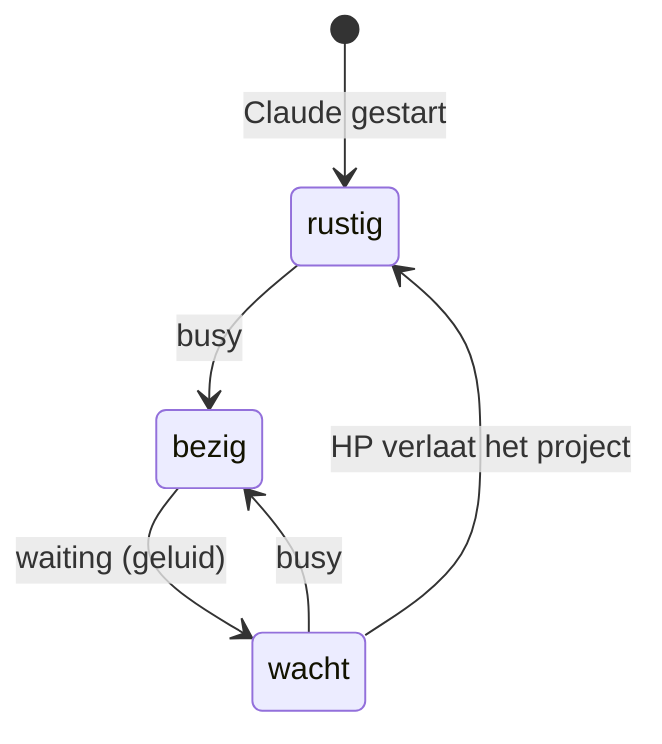
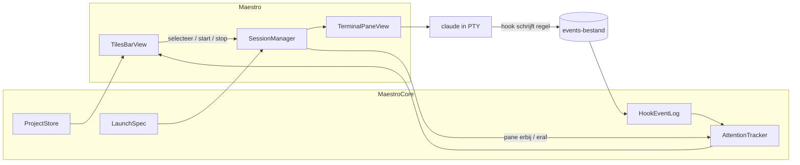

# Maestro - Plan

## Goal Capsule

**Doel:** HP ziet in één oogopslag welk Claude-project op hem wacht en zit met één toets of klik in dat project, met shell en Claude naast elkaar.

**Middel:** een native Mac-app in Swift met SwiftTerm-terminals, waarbij Claude Code hooks de status per sessie doorgeven (KTD1, KTD3).

**Autoriteit:** bij twijfel wint het Product Contract op gedrag, en de KTD's op techniek. `docs/doel.md` is de achtergrond.

**Stop en vraag HP als:** SwiftTerm de Claude-TUI niet bruikbaar rendert (U5), of geen enkele hook een openstaande vraag van Claude meldt (U4). Beide raken de kern van het product.

**Uitvoering:** één ontwikkelaar of agent per unit, volgens de execution table. HP pusht zelf.

---

## Product Contract

### Summary

Maestro vervangt de WezTerm-workspaces van HP. Elk project is een gekleurde tile in een vaste balk. De tile laat zien of Claude bezig is of op HP wacht, en wisselen gaat met een klik, Cmd+cijfer, Cmd+P of één sneltoets naar het eerstvolgende wachtende project.

### Problem Frame

HP werkt in WezTerm met 27 projecten, elk een workspace met tabs voor shell en Claude. Twee dingen schuren. Wisselen tussen projecten kost te veel handelingen. En erger: nergens is te zien welke Claude-sessie klaar is of een vraag heeft, dus sessies staan ongemerkt stil.

### Key Decisions

- **Aandacht betekent: Claude wacht op HP.** Niet elke nieuwe output. (session-settled: user-directed, gekozen boven 'elke nieuwe output' en 'alleen wachtend zonder bezig-indicatie': drie toestanden geven het volledige beeld.) Governs R12, R13.
- **Buiten de balk alleen een geluidje.** (session-settled: user-directed, gekozen boven Dock-badge en macOS-notificatie.) Governs R15.
- **Na een herstart draait er niets.** (session-settled: user-approved, gekozen boven automatisch herstarten: niets start ongevraagd.) Governs R8.
- **Claude hervat altijd het laatste gesprek.** (session-settled: user-directed, gekozen boven 'altijd vers' en 'kiezen per keer'.) Governs R7.
- **Kleur automatisch, later aanpasbaar.** (session-settled: user-approved, gekozen boven een dialoog bij aanmaken.) Governs R19, R20.
- **Alle WezTerm-projecten komen als active binnen.** (session-settled: user-directed, gekozen boven importeren als inactive: HP ruimt zelf op.) Governs R22.
- **Tile 11 tot en met 20 via Cmd+Option, niet Cmd+Shift.** (session-settled: user-directed, gekozen boven Cmd+Shift+cijfer: Cmd+Shift+3, 4 en 5 zijn de schermafbeelding-sneltoetsen van macOS.) Governs R16.
- **'Wacht' vervalt ook als HP het project verlaat.** (session-settled: user-directed, gekozen boven 'alleen bij input' en 'bij selecteren': een bekeken project hoeft niet te blijven wachten, en wat afrondt terwijl HP meekijkt blijft zichtbaar.) Governs R13.
- **Projecten zijn te verwijderen.** (session-settled: user-directed, gekozen boven met de hand `projects.json` bewerken.) Governs R29.
- **Stopt Claude vanzelf, dan blijft het project running.** (session-settled: user-approved, gekozen boven het project naar active zetten: de shell-pane en wat daarin draait blijven ongemoeid.) Governs R30.
- **Cmd+P zoekt over alle projecten, ook inactive.** (session-settled: user-approved, gekozen boven alleen de tiles in de balk.) Governs R18.
- **Native Swift.** (session-settled: user-approved, gekozen boven Tauri en Electron met xterm.js: licht en voelt als een Mac-app.)
- **Versie 1 heeft twee vaste panes; extra panes zijn de eerste uitbreiding.** Een project krijgt daarna een derde en vierde pane, elk een shell of een Claude-sessie. Een aparte server-voorziening vervalt: `./runlocal.sh` start HP zelf in zo'n extra shell-pane. (session-settled: user-approved, gekozen boven extra panes meteen in versie 1: eerst de kern werkend.) Governs R28.

### Requirements

**Window en layout**

- R1. De app heeft één resizable window, bij de eerste start gecentreerd op 3/4 van de schermbreedte en 3/4 van de schermhoogte.
- R2. Bovenaan staat een tiles-balk van 4 em hoog die altijd in beeld blijft, met rechts een + tile. Elke tile toont de toets waarmee hij te kiezen is (R16).
- R3. Onder de balk staat links de zsh-pane (standaard 1/3) en rechts de Claude-pane (standaard 2/3) van het gekozen project.
- R4. De scheidslijn tussen de panes is versleepbaar.
- R5. De balk is ontworpen voor 12 tot 15 tiles: bij dat aantal en de standaard windowbreedte is elke projectnaam herkenbaar. Komen er meer, dan worden de tiles smaller en wordt de naam afgekapt.

**Projecten en status**

- R6. Een project heeft een naam, een folder, een kleur, een positie in de balk en een status: running, active of inactive.
- R7. Running: in de projectfolder draaien een zsh-sessie en `claude --dangerously-skip-permissions`, waarbij Claude het laatste gesprek in die folder hervat. Bestaat er nog geen gesprek, dan start Claude vers.
- R8. Active: het project staat in de balk maar er draait niets. Een klik op de tile zet het op running, en selecteren via een sneltoets doet hetzelfde. Bij het afsluiten van de app stoppen alle sessies en na het openen staan alle running projecten op active.
- R9. Inactive: het project staat niet in de balk en is terug te halen via een dropdown met alle inactive projecten.
- R10. Meerdere projecten kunnen tegelijk running zijn. Wisselen van tile laat de sessies van de andere projecten doorlopen.
- R11. Via rechtsklik op een tile gaat een project van running naar active (sessies stoppen, zonder bevestiging) en van active naar inactive. Een running project kan ook in één keer naar inactive; de sessies stoppen dan eerst.
- R30. Stopt Claude vanzelf, bijvoorbeeld door `/exit`, dan blijft het project running en draait de zsh-pane door. De Claude-pane meldt dat Claude gestopt is en Enter start hem opnieuw volgens R7.

**Aandacht**

- R12. Een running tile toont één van drie toestanden: Claude is bezig, Claude wacht op HP, of rustig. 'Wacht op HP' geldt zodra Claude zijn beurt heeft afgerond of een vraag stelt.
- R13. De toestand 'wacht op HP' vervalt zodra HP in dat project input aan Claude geeft; de tile toont dan bezig. Ze vervalt ook zodra HP het project verlaat voor een ander project; de tile wordt dan rustig. Hetzelfde gebeurt als HP het project kiest dat hij al voor zich heeft, bijvoorbeeld met een klik op de geselecteerde tile.
- R14. In de balk is op zicht te onderscheiden of een tile running of active is, en welke tile geselecteerd is.
- R15. Gaat een project van bezig naar 'wacht op HP', dan klinkt een kort geluid. Geen Dock-badge, geen macOS-notificatie.

**Wisselen**

- R16. Cmd+1 tot en met Cmd+9 selecteren tile 1 tot en met 9 in de balk en Cmd+0 tile 10. Cmd+Option+1 tot en met Cmd+Option+0 selecteren tile 11 tot en met 20.
- R17. Eén sneltoets (Cmd-§) springt naar het eerstvolgende project dat op HP wacht, in balkvolgorde na de huidige tile.
- R18. Cmd+P opent een fuzzy zoeker over alle projecten, ook inactive. Kiezen selecteert het project en zet het zo nodig op running.

**Projecten beheren**

- R19. De + tile opent een folderkiezer. Het nieuwe project krijgt de foldernaam als naam, de eerstvolgende vrije kleur uit een vast palet, en komt als active achteraan in de balk.
- R20. Via rechtsklik op een tile zijn naam en kleur te wijzigen.
- R29. Een active project is via rechtsklik op de tile te verwijderen, en een inactive project via de dropdown. Alleen het project in de app verdwijnt; de folder blijft staan.
- R21. Tiles zijn te verslepen om de volgorde te wijzigen.
- R22. Bij de eerste start importeert de app eenmalig de projecten (naam en folder) uit `~/.wezterm.lua` waarvan de folder bestaat, en zet ze alfabetisch als active in de balk. Het `server_command` wordt niet overgenomen.
- R23. Projecten, volgorde, kleuren, de status active of inactive en de positie van de scheidslijn blijven bewaard tussen sessies van de app.

**Terminals**

- R24. De zsh-pane is een volwaardige login-shell die `~/.zshrc` laadt, zodat Oh My Zsh met het bullet-train thema en de plugins werkt zoals in WezTerm, inclusief de prompt-symbolen.
- R25. Lettertype en lettergrootte (14) van beide panes komen overeen met de huidige WezTerm-setup. De zsh-pane houdt de donkere WezTerm-kleuren. De Claude-pane, de balk en het window hebben een licht thema, en de tiles hebben pastelkleuren.
- R26. In beide panes openen klikbare URL's in de standaardbrowser. Een `file:`-link opent het bestand met `open`.
- R27. Cmd+C kopieert de selectie als die er is, en Cmd+V plakt.

**Uitbreidbaarheid**

- R28. De opzet van versie 1 gaat er niet van uit dat een project precies één shell en één Claude-sessie heeft: een derde en vierde pane (shell of Claude) moeten later toe te voegen zijn zonder de projectopslag, de layout of de aandacht-status om te gooien.

### Key Flows

- F1. Een wachtend project oppakken
  - **Trigger:** HP werkt in project A; Claude in project B rondt zijn beurt af.
  - **Stappen:** het geluid klinkt en tile B toont 'wacht op HP'. HP drukt de spring-sneltoets. Project B is geselecteerd met focus in de Claude-pane. HP typt een antwoord en tile B toont 'bezig'. Heeft HP niets te zeggen en gaat hij terug naar A, dan wordt tile B rustig.
  - **Covers R12, R13, R15, R17.**
- F2. Een project starten
  - **Trigger:** HP klikt op een active tile of kiest een project via Cmd+P.
  - **Stappen:** het project wordt running. Links start zsh in de projectfolder, rechts start Claude en hervat het laatste gesprek. Bestaat de folder niet, dan blijft het project active en verschijnt er een melding.
  - **Covers R7, R8, R18.**
- F3. Een project parkeren
  - **Trigger:** HP rechtsklikt op een running tile en kiest stoppen.
  - **Stappen:** beide sessies stoppen en de tile toont active. Een tweede keer rechtsklik zet het project op inactive en de tile verdwijnt uit de balk.
  - **Covers R9, R11.**

### Acceptance Examples

- AE1. **Covers R12, R15.** Claude in project B stelt halverwege een taak een vraag terwijl project A geselecteerd is. Tile B toont 'wacht op HP' en het geluid klinkt één keer.
- AE2. **Covers R15.** Claude rondt zijn beurt af in het project dat HP op dat moment voor zich heeft. De tile toont 'wacht op HP'; het geluid klinkt ook dan.
- AE3. **Covers R17.** Er wacht geen enkel project. De spring-sneltoets doet niets.
- AE4. **Covers R7.** Een nieuw toegevoegd project zonder eerder Claude-gesprek wordt op running gezet. Claude start met een leeg gesprek, zonder foutmelding.
- AE5. **Covers R8.** Drie projecten zijn running en HP sluit de app. Na het openen zijn de drie tiles active en draait er geen enkel proces.
- AE6. **Covers R18.** HP kiest via Cmd+P een inactive project. Het komt achteraan in de balk, wordt running en is geselecteerd.
- AE7. **Covers R16.** Er staan 14 tiles in de balk. Cmd+3 selecteert de derde, Cmd+0 de tiende en Cmd+Option+2 de twaalfde. Cmd+Option+5 doet niets, want er is geen vijftiende tile.
- AE8. **Covers R5, R22.** Direct na de import staan er tot 27 tiles in de balk. Ze zijn smal en de namen zijn afgekapt, maar elke tile blijft aanklikbaar en aan zijn kleur te onderscheiden.

### Scope Boundaries

Uitgesteld:

- Een derde en vierde pane per project, naar keuze shell of Claude. Trigger: versie 1 is een week in dagelijks gebruik. Dan te beslissen: waar de extra panes staan, of ze na een herstart terugkomen, en hoe de tile zich gedraagt met twee Claude-sessies in één project.
- Dock-badge en macOS-notificaties. Trigger: HP mist wachtende projecten terwijl de app op de achtergrond staat.

Buiten scope:

- Meerdere windows.
- Een apart server-commando per project; extra shell-panes vangen dat op.
- Claude starten zonder `--dangerously-skip-permissions` of met andere vlaggen per project.
- Een instellingenscherm. Kleur en naam gaan via rechtsklik, de rest volgt de WezTerm-setup.
- Distributie aan anderen (App Store, notarisatie, auto-update).

### Dependencies / Assumptions

- Normaal staan er 12 tot 15 projecten in de balk (running plus active). De tot 27 tiles direct na de import zijn een tijdelijke situatie die HP zelf opruimt.
- `claude` is vindbaar via het `PATH` van een zsh login-shell.
- WezTerm gebruikt bij HP het standaard lettertype (JetBrains Mono met Nerd Font-symbolen als fallback) en het standaard kleurenschema; `~/.wezterm.lua` stelt alleen `font_size = 14.0` in. R25 gaat daarvan uit voor het lettertype en voor de kleuren van de zsh-pane.
- Het lichte thema van de Claude-pane vraagt dat Claude Code zelf via `/theme` op light staat.
- AE2 (geluid ook bij het zichtbare project) is een aanname, niet met HP besproken.
- R11 stopt zonder bevestiging, in lijn met `skip_close_confirmation_for_processes_named` in de WezTerm-config.

### Sources / Research

- `docs/doel.md`: het oorspronkelijke doel.
- `~/.wezterm.lua`: de huidige setup met 27 projecten (11 met eigen pad, 16 onder `~/proj/<naam>`), de sneltoetsen Cmd+P, Cmd+C en de link-afhandeling.
- `~/.zshrc`: `ZSH_THEME="bullet-train"`.
- Herkomst: `docs/brainstorms/2026-11-22-maestro-requirements.md`.

---

## Planning Contract

### Key Technical Decisions

- KTD1. **Swift Package met twee targets.** `MaestroCore` bevat alle logica zonder UI en is volledig getest met `swift test`. `Maestro` is het AppKit-programma. Een script bouwt er een `.app` van. Geen Xcode-project: dat is niet te reviewen in een diff en Xcodegen staat niet op de machine.
- KTD2. **SwiftTerm, exact vastgepind op `1.99.3`.** Dat is de nieuwste release en de voorloper van de 2.0-API. Alle API's waar dit plan op leunt bestaan op die tag: synchronized output, bracketed paste, het kitty keyboard protocol, linkdetectie en de glyph-fallback. De `1.20`-lijn mist een deel daarvan en libghostty heeft nog geen stabiele API. De tag vraagt swift-tools 6.2 en draait in Swift 6 language mode met `@MainActor`-delegates; de app-target volgt dat.
- KTD3. **Status komt uit Claude Code hooks, niet uit de terminal-output.** De app start Claude met `--settings <bestand>`. Dat bestand bevat alleen hooks en laat `~/.claude/settings.json` ongemoeid; hooks uit meerdere niveaus worden samengevoegd. Governs R12, R13.
- KTD4. **Hooks schrijven één regel naar een events-bestand.** Elke hook is een vast shell-commando dat `<pane-id> <toestand>` toevoegt aan het bestand in `$MAESTRO_EVENTS`. De pane-id komt uit `$MAESTRO_PANE`; hooks erven de omgeving van het Claude-proces. De app leest nieuwe regels via een `DispatchSource` op het bestand, afgeleverd op de main queue, en leegt het bestand bij de start. Korte regels met `O_APPEND` lopen niet door elkaar, dus er is geen lock nodig. Geen socket, geen daemon, en met `tail -f` te debuggen.
- KTD5. **Toestand hoort bij een pane, niet bij een project.** Een project heeft een lijst panes, elk met een soort (shell of Claude) en een eigen toestand. De tile toont het aggregaat: wacht er één, dan wacht het project; anders is het bezig als er één bezig is. In versie 1 heeft de lijst altijd twee vaste items. Governs R28.
- KTD6. **Elke start van een pane krijgt een nieuwe pane-id.** Een late hook van een gestopte sessie, of van een Claude die een gecrashte app heeft overleefd, draagt een id die de tracker niet kent en wordt genegeerd.
- KTD7. **Claude start via een interactieve login-shell.** Het commando is een vaste tekst: `zsh -lic 'exec claude --dangerously-skip-permissions --continue --settings "$MAESTRO_SETTINGS"'`. Zo komen `PATH` en de rest van de omgeving uit `~/.zshrc`; `-lc` slaat dat bestand over. Het settings-pad gaat als omgevingsvariabele mee, want het bevat altijd een spatie ("Application Support") en zo is er geen quoting-logica nodig. Het pad naar `claude` staat nergens hard in de code.
- KTD8. **Stoppen is ophangen.** Een pane stopt met SIGHUP naar het proces en SIGKILL als vangnet na een korte wachttijd. Een interactieve zsh negeert SIGTERM, en alleen bij SIGHUP ruimt zsh zijn eigen jobs op, zoals een draaiende `./runlocal.sh`. Het pid komt uit `process.shellPid` van SwiftTerm.
- KTD9. **AppKit voor window, split en terminals; SwiftUI voor de tiles-balk en de zoeker.** De terminal is een `NSView`, dus het frame is AppKit. Tiles, contextmenu's en slepen zijn in SwiftUI veel minder code. `ProjectStore` en `AttentionTracker` zijn beide `@MainActor @Observable` en voeden samen de balk.
- KTD10. **Opslag als één JSON-bestand** in `~/Library/Application Support/Maestro/projects.json`. De volgorde in het bestand is de balkvolgorde. `running` en de selectie worden nooit opgeslagen. Een onleesbaar bestand wordt eerst hernoemd naar `projects.corrupt.json`, zodat de eerstvolgende wijziging het niet overschrijft. Windowframe en scheidslijn gaan via de autosave van AppKit, niet via dit bestand. Governs R8, R23.
- KTD11. **Lettertypes zitten in de app.** De vier snitten van JetBrains Mono en Symbols Nerd Font Mono staan in `Support/Fonts/`, gaan naar `Contents/Resources/Fonts` en worden via `ATSApplicationFontsPath` geregistreerd. Zonder de vette en cursieve snitten valt SwiftTerm terug op normaal. Het symbolenfont is aangesloten via `glyphFallbackProvider` van SwiftTerm; de powerline-scheidingstekens tekent SwiftTerm zelf. Governs R24, R25.
- KTD12. **De WezTerm-import is een parser voor precies dit bestand.** Hij herkent de `projects`-tabel (paren van `name` en `cwd`) en de `simple_projects`-lijst, die naar `~/proj/<naam in kleine letters>` wijst. Geen Lua-interpreter voor iets dat één keer draait. Governs R22.

### Toestanden en events

De toestand van een Claude-pane volgt uit vijf hooks.

| Hook | Matcher | Regel in events-bestand |
|---|---|---|
| `UserPromptSubmit` | geen | `<pane> busy` |
| `PostToolUse` | geen | `<pane> busy` |
| `Stop` | geen | `<pane> waiting` |
| `PreToolUse` | `AskUserQuestion` | `<pane> waiting` |
| `Notification` | `idle_prompt`, `agent_needs_input`, `elicitation_dialog`, `permission_prompt` | `<pane> waiting` |



- `waiting` telt alleen vanuit bezig. Op een rustige of wachtende pane doet het niets. Daardoor zet de `idle_prompt`-melding een net gestarte sessie niet op wacht, en ook niet een project dat HP al heeft bekeken en verlaten.
- `busy` telt vanuit elke toestand. `PostToolUse` zonder matcher vangt de gevallen waarin Claude zonder nieuwe prompt weer aan het werk gaat: na een beantwoorde vraag, en na een achtergrondtaak of subagent die hem wekt.
- Verlaat HP een project, dan worden de wachtende panes van dat project rustig (R13).
- Een pane waarvan het proces stopt verdwijnt uit de tracker.

### Opbouw



### Output Structure

```
Package.swift
runlocal.sh
scripts/build-app.sh
Support/Info.plist
Support/Fonts/
Sources/MaestroCore/
  Project.swift            ProjectStore.swift     ColorPalette.swift
  WezTermImporter.swift    Attention.swift        HookEventLog.swift
  HookSettings.swift       LaunchSpec.swift       FuzzyMatcher.swift
Sources/Maestro/
  main.swift               AppDelegate.swift      MainWindowController.swift
  TilesBarView.swift       TerminalPaneView.swift TerminalTheme.swift
  SessionManager.swift     QuickOpenPanel.swift   MainMenu.swift
Tests/MaestroCoreTests/
docs/architecture.md
```

### Aannames

- De selectie wordt niet bewaard. Bij de start van de app, en nadat het geselecteerde project is gestopt, op inactive gezet of verwijderd, is er geen selectie en toont het window onder de balk een lege vlakte met een korte hint.
- Het window sluiten sluit de app af.
- Stopt de zsh-sessie vanzelf, dan start in dezelfde pane een nieuwe. Stopt een proces binnen twee seconden na de start, dan blijft de pane met zijn uitvoer staan en start er niets opnieuw, zodat een foutmelding leesbaar blijft.
- Bestaat de folder van een project niet bij het starten, dan blijft het project active en verschijnt er één melding.
- Een folder toevoegen die al een project is, maakt geen tweede project. Is het project inactive, dan komt het als active achteraan in de balk; is het running, dan wordt het geselecteerd. Er start niets.
- Twee projecten mogen dezelfde naam hebben; de zoeker toont de folder erbij.
- Een project terughalen via de dropdown maakt het active en zet het achteraan in de balk.
- Verwijderen vraagt geen bevestiging: alleen naam, kleur en positie gaan verloren.
- Cmd-§ zonder geselecteerd project zoekt vanaf de eerste tile.
- De import draait hoogstens één keer: na de eerste start bestaat `projects.json` altijd, ook als er niets te importeren viel.
- Logging gaat via `os.Logger`; Justlog en Janitor zijn Python en gelden hier niet.

### Risico's

- **Esc onderbreekt Claude zonder `Stop`-hook.** De tile blijft dan 'bezig' tot de `idle_prompt`-notificatie na ongeveer 60 seconden, of tot HP een nieuwe prompt geeft. Geaccepteerd voor versie 1. Trigger voor een oplossing: HP ziet meer dan eens per dag een tile die ten onrechte 'bezig' toont. Kandidaat: de OSC 7501-statusmelding van Claude Code uitlezen.
- **Hook-gedrag is deels niet gedocumenteerd.** Onbevestigd: of `PreToolUse` vuurt voor `AskUserQuestion`, of slash-commando's `UserPromptSubmit` geven, en welk event volgt op een beantwoorde `elicitation_dialog`. U4 controleert dit eerst in een echte sessie. Meldt geen enkele hook een openstaande vraag, dan is dat de stopconditie uit de Goal Capsule.
- **`claude --continue` zonder eerder gesprek** start vers in `-p` modus (getest met CLI 2.1.319). Voor de interactieve modus is dat niet bevestigd; U5 controleert het voor AE4.
- **`exec claude` volgt geen aliassen**, en de update-vraag van Oh My Zsh kan vóór de `exec` verschijnen. U5 controleert beide op de machine van HP.
- **SwiftTerm `1.99.3` is een preview.** De API kan tot 2.0 nog schuiven; daarom de exacte pin. Twee open issues zonder fix: het teken `⎿` wordt op 60 procent getekend, afhankelijk van het font (issue 833), en in het alternate screen is er geen eigen scrollback, het scrollwiel gaat daar naar het programma zelf (issue 583). U5 controleert beide met de Claude-TUI.
- **Privacy-meldingen keren terug na elke build.** De bundle is ad-hoc gesigneerd, dus macOS vraagt na elke rebuild opnieuw toestemming voor Documents, Desktop en Downloads. Dat speelt tijdens het bouwen, niet bij dagelijks gebruik van één build.
- **Een tweede app-instantie leegt het events-bestand** van de eerste. `HookEventLog` begint daarom opnieuw bij nul als het bestand korter is dan zijn leespositie.
- **Niet tegen Apple-documentatie gecontroleerd:** de sleutels in de Info.plist, het gedrag van `ATSApplicationFontsPath` in een met de hand gebouwde bundle, en Cmd+Option+cijfer en Cmd-§ als menu-sneltoets op het toetsenbord van HP. U1, U5 en U7 hebben er elk een controlepunt voor.

---

## Implementation Units

| # | Task | Touches | Depends on |
|---|------|---------|------------|
| U1 | Skelet: package, app-bundle, leeg window | `Package.swift`, `runlocal.sh`, `scripts/build-app.sh`, `Support/Info.plist`, `.gitignore`, `Sources/Maestro/main.swift`, `Sources/Maestro/AppDelegate.swift`, `Sources/Maestro/MainWindowController.swift`, `Sources/MaestroCore/Project.swift`, `Tests/MaestroCoreTests/ProjectTests.swift` | - |
| U2 | Projectopslag en kleurenpalet | `Sources/MaestroCore/ProjectStore.swift`, `Sources/MaestroCore/ColorPalette.swift`, `Tests/MaestroCoreTests/ProjectStoreTests.swift`, `Tests/MaestroCoreTests/ColorPaletteTests.swift` | U1 |
| U3 | WezTerm-import | `Sources/MaestroCore/WezTermImporter.swift`, `Tests/MaestroCoreTests/WezTermImporterTests.swift` | U1 |
| U4 | Aandacht: hooks, events en toestanden | `Sources/MaestroCore/Attention.swift`, `Sources/MaestroCore/HookEventLog.swift`, `Sources/MaestroCore/HookSettings.swift`, `Tests/MaestroCoreTests/AttentionTests.swift`, `Tests/MaestroCoreTests/HookEventLogTests.swift`, `Tests/MaestroCoreTests/HookSettingsTests.swift` | U1 |
| U5 | Terminal-panes en sessies | `Sources/MaestroCore/LaunchSpec.swift`, `Tests/MaestroCoreTests/LaunchSpecTests.swift`, `Sources/Maestro/TerminalPaneView.swift`, `Sources/Maestro/TerminalTheme.swift`, `Sources/Maestro/SessionManager.swift`, `Support/Fonts/` | U4 |
| U6 | Window-layout en tiles-balk | `Sources/Maestro/MainWindowController.swift`, `Sources/Maestro/TilesBarView.swift`, `Sources/Maestro/AppDelegate.swift` | U2, U4, U5 |
| U7 | Sneltoetsen, zoeker, geluid, import bij eerste start | `Sources/MaestroCore/FuzzyMatcher.swift`, `Tests/MaestroCoreTests/FuzzyMatcherTests.swift`, `Sources/Maestro/MainMenu.swift`, `Sources/Maestro/QuickOpenPanel.swift`, `Sources/Maestro/AppDelegate.swift`, `docs/architecture.md` | U3, U6 |

Na U1 kunnen U2, U3 en U4 parallel: geen van de drie raakt `Package.swift` of een bestand van een ander. U5 volgt op U4. U6 en U7 zijn één draad.

### U1. Skelet: package, app-bundle, leeg window

**Goal:** `./runlocal.sh` bouwt en opent een `Maestro.app` met een leeg window op de juiste maat, en `swift test` draait groen.

**Requirements:** R1.

**Dependencies:** geen.

**Files:** `Package.swift`, `runlocal.sh`, `scripts/build-app.sh`, `Support/Info.plist`, `.gitignore`, `Sources/Maestro/main.swift`, `Sources/Maestro/AppDelegate.swift`, `Sources/Maestro/MainWindowController.swift`, `Sources/MaestroCore/Project.swift`, `Tests/MaestroCoreTests/ProjectTests.swift`

**Approach:**

1. `git init` in de projectfolder; `.gitignore` voor `.build/` en `build/`.
2. `Package.swift` declareert beide targets uit KTD1, de testtarget en SwiftTerm volgens KTD2. Minimum macOS 14 vanwege `@Observable`.
3. `Project.swift` bevat de typen die de andere units delen: `Project` (id, naam, pad, kleur), `ProjectStatus` (running, active, inactive), `PaneID`, `PaneKind` (shell, claude) en `AttentionState` (rustig, bezig, wacht). Zo raken U2, U3, U4 en U5 elkaars bestanden niet en verzint niemand een eigen pane-id.
4. `main.swift` zet de app op als gewone app met een Dock-icoon en een hoofdmenu dat in code is opgebouwd.
5. `Support/Info.plist` bevat `CFBundleExecutable`, `CFBundleIdentifier`, `CFBundleName`, `CFBundlePackageType`, beide versiesleutels, `LSMinimumSystemVersion`, `NSPrincipalClass`, `NSHighResolutionCapable` en `ATSApplicationFontsPath` met de waarde `Fonts` (KTD11).
6. `scripts/build-app.sh` bouwt de binary, zet hem met de Info.plist in `build/Maestro.app`, kopieert `Support/Fonts/` naar `Contents/Resources/Fonts` en signeert de bundle ad-hoc.
7. `runlocal.sh` roept het buildscript aan en opent de app.
8. Het window is resizable, onthoudt zijn frame via frame autosave, en opent zonder opgeslagen frame gecentreerd op 3/4 van het zichtbare scherm. Het window sluiten sluit de app af.

**Execution note:** vooral packaging; een rooktest (de app start en het window heeft de juiste maat) weegt hier zwaarder dan unit tests.

**Test scenarios:**

- Een `Project` gaat via JSON heen en terug zonder verlies van id, naam, pad en kleur.
- De berekening van het startframe geeft voor een scherm van 1600 bij 1000 een window van 1200 bij 750, gecentreerd.

**Verification:**

- `swift build` en `swift test` slagen.
- `./runlocal.sh` opent een window op 3/4 van het scherm, met een Dock-icoon en een menubalk.
- Na verplaatsen en opnieuw starten staat het window waar het stond.
- Het window sluiten beëindigt het proces.

### U2. Projectopslag en kleurenpalet

**Goal:** één store die projecten beheert en bewaart, met alle regels voor status en volgorde.

**Requirements:** R6, R8, R9, R19, R20, R21, R23, R29. Covers AE5, AE6.

**Dependencies:** U1.

**Files:** `Sources/MaestroCore/ProjectStore.swift`, `Sources/MaestroCore/ColorPalette.swift`, `Tests/MaestroCoreTests/ProjectStoreTests.swift`, `Tests/MaestroCoreTests/ColorPaletteTests.swift`

**Approach:**

- `ProjectStore` houdt de geordende lijst projecten, de status per project en het geselecteerde project bij (KTD9).
- Opslag volgens KTD10. Elke wijziging schrijft het bestand atomair weg. De locatie is injecteerbaar zodat tests een tijdelijke map gebruiken.
- De balk toont running en active projecten in lijstvolgorde. Inactive projecten houden hun plek niet: terughalen zet ze achteraan.
- `ColorPalette` is een vaste lijst van 16 goed te onderscheiden pastelkleuren, als achtergrond voor donkere tekst. De volgende kleur is de eerste die nog niet in gebruik is, en anders de minst gebruikte.
- De regels voor een al bekende folder en voor de selectie staan onder Aannames.

**Execution note:** test-first; dit is pure logica.

**Test scenarios:**

- Een project toevoegen met pad `/a/b/mijnproject` geeft naam `mijnproject`, status active, de eerste vrije kleur en de laatste positie.
- Een tweede project krijgt een andere kleur dan het eerste.
- Bij 17 projecten krijgt het zeventiende de minst gebruikte kleur.
- De folder van een active project nogmaals toevoegen levert geen tweede project op en verandert de selectie niet.
- De folder van een inactive project toevoegen maakt het active en zet het achteraan in de balk.
- De folder van een running project toevoegen selecteert dat project.
- Twee projecten met dezelfde naam en een verschillende folder bestaan naast elkaar.
- Verplaatsen van positie 3 naar positie 1 schuift de rest op en overleeft opslaan en laden.
- Covers AE5. Drie projecten op running, opslaan, laden: alle drie zijn active en er is geen selectie.
- Een project op inactive verdwijnt uit de balklijst en verschijnt in de lijst van inactive projecten.
- Het geselecteerde project op inactive zetten laat de store zonder selectie achter.
- Covers AE6. Een inactive project terughalen zet het achteraan in de balk.
- Een verwijderd project komt in geen enkele lijst meer voor, ook niet na opslaan en laden.
- Het geselecteerde project verwijderen laat de store zonder selectie achter.
- Naam en kleur wijzigen overleeft opslaan en laden.
- Een naam van alleen spaties wordt geweigerd en de oude naam blijft staan.
- Een ontbrekend bestand geeft een lege store, en na de eerste bewaaractie bestaat het bestand.
- Een bestand met kapotte JSON geeft een lege store en staat daarna als `projects.corrupt.json` naast de nieuwe opslag.

**Verification:** alle scenario's slagen in `swift test`.

### U3. WezTerm-import

**Goal:** de projecten uit `~/.wezterm.lua` als lijst van naam en folder.

**Requirements:** R22.

**Dependencies:** U1.

**Files:** `Sources/MaestroCore/WezTermImporter.swift`, `Tests/MaestroCoreTests/WezTermImporterTests.swift`

**Approach:**

- De parser volgt KTD12 en krijgt de bestandsinhoud en de homefolder als invoer, zodat hij zonder schijf te testen is.
- De fixture heeft de vorm van het `projects`- en `simple_projects`-deel van de echte `~/.wezterm.lua`, met verzonnen projecten, en staat als tekst in het testbestand zelf. Zo is er geen resource-declaratie in `Package.swift` nodig.
- Het resultaat is alfabetisch op naam gesorteerd, net als in WezTerm.
- Het filteren op bestaande folders gebeurt door de aanroeper (U7), niet in de parser.

**Execution note:** test-first tegen de fixture.

**Test scenarios:**

- De fixture levert 27 projecten op.
- `Elevate Curriculum Genie` krijgt het pad `<home>/proj/elevate/Curriculum Design Tool`, met de spaties intact.
- `Justai` uit `simple_projects` krijgt het pad `<home>/proj/justai`.
- `server_command` komt nergens in het resultaat terug.
- Het resultaat is alfabetisch gesorteerd.
- Een leeg bestand en een bestand zonder `projects`-tabel leveren een lege lijst op.
- Een item met een `name` maar zonder `cwd` wordt overgeslagen.

**Verification:** alle scenario's slagen in `swift test`.

### U4. Aandacht: hooks, events en toestanden

**Goal:** van een regel in het events-bestand naar de juiste toestand per pane en per project.

**Requirements:** R12, R13, R15, R17, R28. Covers AE1, AE2, AE3.

**Dependencies:** U1.

**Files:** `Sources/MaestroCore/Attention.swift`, `Sources/MaestroCore/HookEventLog.swift`, `Sources/MaestroCore/HookSettings.swift`, `Tests/MaestroCoreTests/AttentionTests.swift`, `Tests/MaestroCoreTests/HookEventLogTests.swift`, `Tests/MaestroCoreTests/HookSettingsTests.swift`

**Approach:**

1. Controleer eerst met de hand in een echte interactieve Claude-sessie, gestart met een proef-settingsbestand, welke hooks vuren bij:
   - een gewone prompt en de afronding ervan;
   - een vraag via `AskUserQuestion`, en het antwoord daarop;
   - een slash-commando;
   - een achtergrondtaak of subagent die Claude na een `Stop` weer aan het werk zet;
   - een verse en een hervatte sessie die 60 seconden met rust wordt gelaten.
   Wijkt de uitkomst af van de tabel onder 'Toestanden en events', pas dan die tabel en de tests aan vóór de code.
2. `HookSettings` genereert het JSON-bestand voor `--settings` met de hooks uit die tabel (KTD3, KTD4).
3. `HookEventLog` leest nieuwe bytes vanaf de laatste positie, bewaart een onvolledige laatste regel tot de rest binnen is, en levert geparste events op. Is het bestand korter dan de leespositie, dan begint het opnieuw bij nul. Het bestandspad is injecteerbaar.
4. `AttentionTracker` houdt de toestand per geregistreerde pane bij volgens het toestandsdiagram en meldt overgangen van bezig naar wacht, zodat de app het geluid kan afspelen.
5. Het aggregaat per project volgt KTD5.
6. De keuze voor 'eerstvolgende wachtende' is een pure functie: gegeven de balkvolgorde, het huidige project en de toestanden geeft ze het eerste wachtende project na het huidige, met doorloop naar het begin.

**Execution note:** stap 1 vóór alle code; de rest test-first.

**Test scenarios:**

- Het gegenereerde settingsbestand is geldige JSON met precies de vijf hooks uit de tabel, elk met het juiste event en de juiste matcher.
- Een regel `<id> busy` zet een rustige pane op bezig.
- Covers AE1. `busy` gevolgd door `waiting` zet de pane op wacht en meldt één overgang.
- `busy` op een wachtende pane zet hem op bezig.
- Een tweede `waiting` op een wachtende pane meldt geen overgang.
- `waiting` op een rustige pane laat hem rustig en meldt geen overgang.
- Het project verlaten zet een wachtende pane op rustig en laat een bezige pane bezig.
- Na verlaten en een nieuwe `busy` gevolgd door `waiting` wacht de pane opnieuw en is er weer één overgang gemeld.
- Een regel met een id die niet geregistreerd is, bijvoorbeeld van een eerdere start, wordt genegeerd.
- Een regel met een onbekende toestand, een lege regel en een regel zonder spatie worden genegeerd zonder crash.
- Een regel die in twee stukken binnenkomt levert pas na het tweede stuk één event op.
- Wordt het bestand tussendoor geleegd, dan worden regels die daarna worden toegevoegd gewoon gelezen.
- Een afgemelde pane verdwijnt uit het aggregaat.
- Een project met één wachtende en één bezige pane toont wacht.
- Een project met alleen een shell-pane en een rustige Claude-pane toont rustig.
- Covers AE3. Zonder wachtende projecten geeft de springfunctie niets terug.
- Met wachtende projecten op positie 2 en 5 en het huidige op 3 geeft de springfunctie 5; vanaf 5 geeft ze 2.
- Zonder huidig project geeft de springfunctie het eerste wachtende project in de balk.
- Covers AE2. Is het huidige project het enige wachtende, dan geeft de springfunctie niets terug; de overgang naar wacht is voor dat project wel gemeld.

**Verification:** alle scenario's slagen in `swift test`. De handmatige controle uit stap 1 is gedaan en de uitkomst staat genoteerd voor `docs/architecture.md`.

### U5. Terminal-panes en sessies

**Goal:** een project op running zetten start twee werkende terminals; stoppen ruimt ze op.

**Requirements:** R7, R10, R11, R24, R25, R26, R27, R30. Covers AE4.

**Dependencies:** U4.

**Files:** `Sources/MaestroCore/LaunchSpec.swift`, `Tests/MaestroCoreTests/LaunchSpecTests.swift`, `Sources/Maestro/TerminalPaneView.swift`, `Sources/Maestro/TerminalTheme.swift`, `Sources/Maestro/SessionManager.swift`, `Support/Fonts/`

**Approach:**

- `LaunchSpec` bouwt per pane-soort het programma, de argumenten, de omgeving en de werkmap. Het is pure logica en dus getest.
  - Shell: de zsh uit `$SHELL` als login-shell in de projectfolder.
  - Claude: het vaste commando uit KTD7.
  - Omgeving: `HOME`, `USER`, `SHELL`, `LANG=en_US.UTF-8`, `TERM=xterm-256color`, `COLORTERM=truecolor`, plus `MAESTRO_PANE`, `MAESTRO_EVENTS` en `MAESTRO_SETTINGS`.
- `TerminalPaneView` is een subklasse van `LocalProcessTerminalView`. `linkHighlightMode` staat op `.hover`, zodat een gewone klik een link opent. De standaard afhandeling van SwiftTerm opent URL's en bestanden via `NSWorkspace` en blokkeert links naar scripts en programma's met een melding; dat blijft zo.
- `TerminalTheme` zet JetBrains Mono 14 met de fallback uit KTD11 en kiest het palet per pane-soort. De zsh-pane krijgt het standaardpalet van WezTerm: voorgrond `#b2b2b2`, achtergrond `#000000`, cursor `#52ad70`, en de 16 ANSI-kleuren uit `term/src/color.rs` van WezTerm. De Claude-pane krijgt een licht palet in de stijl van GitHub Light: voorgrond `#24292f`, achtergrond `#ffffff`, cursor `#0969da`.
- `SessionManager` houdt per running project de panes en hun views vast, geeft elke gestarte pane een nieuwe id (KTD6) en meldt Claude-panes aan en af bij de tracker.
- Views van niet-geselecteerde projecten blijven bestaan. SwiftTerm blijft hun uitvoer verwerken en bewaart de scrollback, ook als de view niet in het window zit.
- Vóór het starten controleert de manager of de projectfolder bestaat.
- Stoppen volgt KTD8, ook voor alle sessies bij het afsluiten van de app.
- Stopt Claude vanzelf, dan geldt R30: de pane blijft staan met een regel dat Claude gestopt is, en Enter start een nieuwe sessie met een nieuwe pane-id.
- Het gedrag bij een zsh die stopt en bij een proces dat binnen twee seconden stopt staat onder Aannames.
- De fonts komen uit de officiële releases van JetBrains Mono en Nerd Fonts; de licentiebestanden gaan mee in `Support/Fonts/`.

**Execution note:** begin met één pane die de Claude-TUI draait en beoordeel de weergave, vóór de sessiemanager. Dit is de stopconditie uit de Goal Capsule.

**Test scenarios:**

- De spec voor een shell-pane heeft de projectfolder als werkmap en start zsh als login-shell.
- De spec voor een Claude-pane is het vaste commando uit KTD7, ongeacht het settings-pad.
- Een projectpad met spaties (`Curriculum Design Tool`) komt ongeschonden in de werkmap terecht.
- `MAESTRO_SETTINGS` bevat het settings-pad letterlijk, ook met een spatie of een aanhalingsteken erin.
- Beide specs bevatten `MAESTRO_PANE` met de eigen pane-id en hetzelfde `MAESTRO_EVENTS`.
- Twee keer een spec bouwen voor hetzelfde project levert twee verschillende pane-id's op.
- `LANG` is altijd gezet, ook als de app zonder `LANG` in zijn omgeving start.

**Verification:**

- De zsh-pane toont de bullet-train prompt met de juiste symbolen, ook in vet, en dezelfde kleuren als in WezTerm.
- `type claude` in de zsh-pane wijst naar een programma, niet naar een alias.
- Covers AE4. Claude start in een folder zonder eerder gesprek met een leeg gesprek en zonder foutmelding.
- Claude start in een folder met een eerder gesprek en toont dat gesprek.
- Het teken `⎿` in de Claude-TUI heeft een normale grootte.
- Scrollen met het trackpad in de Claude-pane bladert door het gesprek.
- Een URL in de Claude-pane opent met één klik in de browser, en een `file:`-link naar een tekstbestand opent dat bestand.
- Cmd+C kopieert een selectie en Cmd+V plakt.
- Shift+Enter geeft in Claude een nieuwe regel.
- `sleep 1000` in de zsh-pane is weg na het stoppen van het project, en ook na het afsluiten van de app.
- Na `/exit` in Claude blijft het project running, draait de zsh-pane door, en start Enter in de Claude-pane een nieuwe sessie met het vorige gesprek.
- Met een onvindbare `claude` blijft de foutmelding in de pane staan.
- Een project waarvan de folder is hernoemd geeft bij het starten één melding en blijft active.

### U6. Window-layout en tiles-balk

**Goal:** de volledige bediening met de muis: tiles, panes, scheidslijn, contextmenu, + en de dropdown.

**Requirements:** R2, R3, R4, R5, R9, R11, R12, R13, R14, R19, R20, R21, R23, R29. Covers F2, F3, AE8.

**Dependencies:** U2, U4, U5.

**Files:** `Sources/Maestro/MainWindowController.swift`, `Sources/Maestro/TilesBarView.swift`, `Sources/Maestro/AppDelegate.swift`

**Approach:**

- Het window bestaat uit de balk bovenaan en daaronder één `NSSplitView`. Bij wisselen van project worden de twee terminal-views van dat project in de split gezet. De scheidslijn staat zonder opgeslagen positie op 1/3 en wordt bewaard via `autosaveName` (KTD10).
- Wisselen van project meldt het verlaten van het vorige project aan de tracker (R13) en geeft de Claude-pane van het nieuwe project de focus.
- De balk is SwiftUI (KTD9), 56 punten hoog, met een lichtgrijze achtergrond. De tiles delen de breedte gelijk, met een maximum per tile. Een tile toont boven de naam de toets uit R16 en de naam op hoogstens twee regels. De volledige naam staat in de tooltip.
- Weergave per tile:
  - active: projectkleur gedempt, naam in een rustige tint;
  - running: volle projectkleur;
  - geselecteerd: een duidelijke rand of streep onder de tile;
  - bezig: een kleine draaiende indicator;
  - wacht: een opvallende, pulserende stip. Dit is het signaal waar het product om draait en moet ook op een smalle tile zichtbaar blijven.
- Rechts in de balk staan de dropdown met inactive projecten en de + tile. Elk inactive project heeft in de dropdown twee acties: terugzetten en verwijderen. De dropdown is uitgeschakeld als er geen inactive projecten zijn.
- Het contextmenu van een tile bevat: stoppen (alleen bij running), naar inactive, verwijderen (alleen bij active), hernoemen, en een submenu met de kleuren uit het palet.
- De + opent een `NSOpenPanel` voor folders.
- Slepen van een tile wijzigt de volgorde via de store.
- `AppDelegate` maakt de store, de tracker, het events-bestand en de sessiemanager aan en verbindt ze.

**Test expectation:** geen unit tests; de logica zit in U2 en U4. De controle is de lijst hieronder.

**Verification:**

- Na de start is er geen project geselecteerd, draait er niets en staat onder de balk de hint.
- Covers F2. Een klik op een active tile start beide panes, de tile krijgt de volle kleur en de focus staat in de Claude-pane.
- Covers F3. Stoppen via het contextmenu maakt de tile gedempt en laat de hint zien; daarna naar inactive laat hem verdwijnen en in de dropdown verschijnen.
- Terugzetten vanuit de dropdown zet de tile als active achteraan in de balk.
- Verwijderen via het contextmenu en via de dropdown haalt het project overal weg; de folder op schijf staat er nog.
- De + voegt een gekozen folder toe als active tile achteraan, met de foldernaam en een nog niet gebruikte kleur.
- Naam en kleur wijzigen via het contextmenu is direct zichtbaar en staat er na een herstart nog.
- Een tile verslepen wijzigt de volgorde, ook na een herstart.
- Zonder opgeslagen positie staat de scheidslijn op 1/3. Hij is te verslepen en staat na een herstart op dezelfde plek.
- Twee projecten zijn running; wisselen tussen de tiles laat in beide de uitvoer doorlopen, en na het wisselen is de terminal scherp en op de juiste maat getekend.
- Een prompt aan Claude toont de bezig-indicator; na afloop toont de tile de stip.
- Een nieuwe prompt in een wachtend project zet de tile terug op bezig.
- Een wachtend project bekijken en naar een ander project gaan maakt de tile rustig.
- Met 14 tiles bij de standaard windowbreedte is elke naam herkenbaar.
- Covers AE8. Met alle geïmporteerde tiles in de balk zijn ze smal, maar elke tile is aanklikbaar en aan zijn kleur te onderscheiden.
- De balk blijft zichtbaar als het window zo klein mogelijk wordt gemaakt.

### U7. Sneltoetsen, zoeker, geluid, import bij eerste start

**Goal:** alles wat HP zonder muis doet, plus de eenmalige import en het geluid.

**Requirements:** R15, R16, R17, R18, R22, R27. Covers F1, AE1, AE2, AE6, AE7.

**Dependencies:** U3, U6.

**Files:** `Sources/MaestroCore/FuzzyMatcher.swift`, `Tests/MaestroCoreTests/FuzzyMatcherTests.swift`, `Sources/Maestro/MainMenu.swift`, `Sources/Maestro/QuickOpenPanel.swift`, `Sources/Maestro/AppDelegate.swift`, `docs/architecture.md`

**Approach:**

- Alle sneltoetsen zijn menu-items in `MainMenu`. SwiftTerm laat Cmd-combinaties aan het menu zolang `shouldSendCommandKeyToTerminal` niet is gezet; dat blijft zo.
  - Menu Projecten: de twintig tile-sneltoetsen uit R16, Cmd+P voor de zoeker en Cmd-§ voor 'spring naar wachtende'.
  - Menu Bewerken: kopiëren, plakken en alles selecteren, gericht op de first responder. Daarmee werkt R27 via SwiftTerm.
- `FuzzyMatcher` geeft per kandidaat een score: alle getypte tekens moeten in volgorde voorkomen, hoofdletters tellen niet, en aaneengesloten treffers en treffers aan het begin van een woord scoren hoger.
- `QuickOpenPanel` is een klein zwevend paneel met een zoekveld en een lijst over alle projecten, inactive inbegrepen, met per project de naam en de folder. Pijltjes en Enter kiezen, Esc sluit.
- Het geluid is een systeemgeluid dat klinkt bij elke overgang die de tracker meldt, ook als de app op de achtergrond staat.
- Eerste start: bestaat `projects.json` niet, dan worden de projecten uit `~/.wezterm.lua` met een bestaande folder als active toegevoegd en wordt het bestand geschreven, ook als er niets te importeren viel.
- `docs/architecture.md` beschrijft de twee targets, de keten van hook tot tile, de uitkomst van de hook-controle uit U4, en de locaties van `projects.json` en het events-bestand.

**Execution note:** `FuzzyMatcher` test-first; de rest via de lijst hieronder.

**Test scenarios:**

- `gm` vindt `Golfmaster`; `xyz` vindt het niet.
- `ele tra` rangschikt `Elevate Translate` boven `Elevate Tony`.
- Een lege zoekterm geeft alle projecten in balkvolgorde, inactive achteraan.
- Hoofdletters in de zoekterm maken geen verschil.
- Een zoekterm langer dan de naam geeft geen treffer en geen crash.

**Verification:**

- Covers AE7. Met 14 tiles selecteert Cmd+3 de derde, Cmd+0 de tiende en Cmd+Option+2 de twaalfde; Cmd+Option+5 doet niets.
- Cmd+cijfer op een active tile start dat project.
- Covers F1. Claude rondt af in project B terwijl A geselecteerd is: het geluid klinkt één keer, Cmd-§ selecteert B met de focus in de Claude-pane, en een antwoord zet tile B op bezig.
- Covers AE1. Claude stelt in project B een vraag via `AskUserQuestion` terwijl A geselecteerd is: tile B toont de stip en het geluid klinkt één keer.
- Covers AE2. Claude rondt af in het project dat HP voor zich heeft: de tile toont de stip en het geluid klinkt.
- Het geluid klinkt ook als een andere app op de voorgrond staat.
- Cmd+P met een deel van de naam van een running project selecteert dat project.
- Covers AE6. Een inactive project kiezen via Cmd+P zet het achteraan in de balk, running en geselecteerd.
- Alle sneltoetsen werken terwijl de focus in de zsh-pane en in de Claude-pane staat, op het toetsenbord van HP.
- Een eerste start zonder `projects.json` toont de projecten uit `~/.wezterm.lua` alfabetisch als active tiles; een tweede start importeert niets opnieuw.
- Een eerste start zonder `~/.wezterm.lua` geeft een lege balk en een bestaande `projects.json`.
- Afsluiten met drie running projecten laat geen `claude`- of `zsh`-processen achter.

---

## Verification Contract

- `swift build` slaagt zonder waarschuwingen in eigen code.
- `swift test` slaagt; alle logica in `MaestroCore` heeft tests.
- `./runlocal.sh` bouwt en opent `build/Maestro.app`.
- De Verification-lijsten van U5, U6 en U7 zijn met de hand doorlopen in de gebouwde app, met echte Claude-sessies. Samen dekken ze AE1 tot en met AE8 en F1 tot en met F3.
- R28 is geen gedrag maar een ontwerpeis. Het bewijs is dat pane-id's, de tracker en `LaunchSpec` nergens uitgaan van precies één shell en één Claude per project; de test met twee panes in één project in U4 dekt dat.

## Definition of Done

- Elke requirement R1 tot en met R30 is terug te vinden in een geslaagde test of een afgevinkt verificatiepunt.
- HP heeft een werkdag met Maestro in plaats van WezTerm gewerkt zonder terug te vallen.
- De uitkomst van de hook-controle uit U4 staat beschreven in `docs/architecture.md`.
- Code van afgebroken pogingen en proefbestanden voor de hook-controle zijn verwijderd.
- Er is niets gepusht.
