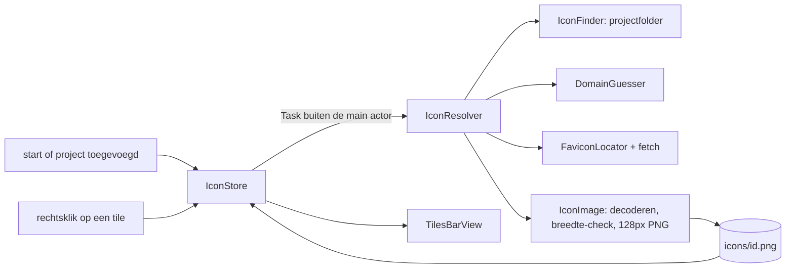

# Tiles met iconen - Plan

## Goal Capsule

**Doel:** HP herkent een project in de balk aan zijn icoon in plaats van aan een gekleurd vlak met tekst, en de balk oogt rustiger.

**Middel:** elke tile toont een icoon met de projectnaam klein eronder. De app zoekt de iconen zelf, in de projectfolder en via de website van het project. De projectkleur blijft alleen over als achtergrond van de initialen bij een project zonder icoon.

**Product-autoriteit:** HP, enige gebruiker.

**Open blockers:** geen.

## Product Contract

### Summary

Een tile wordt een icoon met de naam eronder, zoals in het Dock met labels. De app zoekt voor elk project zelf een icoon: eerst in de projectfolder, daarna als favicon van een website die HP invult of die de app raadt. Een gevonden icoon staat direct op de tile en is via rechtsklik te corrigeren. Een project zonder icoon toont zijn initialen op de pastelkleur van het project. Draaiende projecten staan in kleur, gestopte in grijstinten en vervaagd. De indicatoren voor bezig en 'wacht op HP' blijven, als badge op het icoon.

### Problem Frame

De tiles zijn nu gekleurde vlakken met een naam. Het palet heeft 16 pasteltinten, dus kleuren komen dubbel voor en zeggen weinig over het project. Herkennen gaat via lezen. Ruimte is niet het probleem: de balk past. HP wil sneller zien welke tile welk project is, en een balk die er beter uitziet.

### Key Decisions

- **Icoon met de naam eronder.** (session-settled: user-directed, gekozen na een schets met drie varianten, boven 'alleen icoon' en 'icoon naast de naam'.) Governs R31, R32.
- **De balk wordt 20% hoger.** Iconen en indicatoren kunnen daardoor iets groter. (session-settled: user-directed.) Governs R33.
- **De pastelkleuren blijven, alleen voor initialen.** Zonder icoon toont de tile initialen op de projectkleur. (session-settled: user-directed, gekozen na een schets, boven 'initialen op neutraal grijs' en 'wit op donker voor draaiende projecten': op grijs leek een draaiend project zonder icoon gestopt.) Governs R34, R35.
- **De geselecteerde tile heeft een wit vlak met een donkere streep eronder.** (session-settled: user-approved, na een schets.) Governs R37.
- **Gestopt is grijstinten plus vervaagd, draaiend is volle kleur.** (session-settled: user-directed, gekozen boven 'alleen vervaagd' en 'volledig grijs zonder vervagen': een icoon dat zelf grijs is blijft zo ook te onderscheiden.) Governs R36.
- **Het sneltoetscijfer is alleen zichtbaar met Cmd ingedrukt.** (session-settled: user-directed, gekozen boven 'klein in een hoek' en 'niet tonen'.) Governs R38.
- **De app zoekt in de folder en raadt ook de website.** (session-settled: user-directed, gekozen boven 'niets raden' en 'geen netwerk': meer iconen zonder werk, met de kans op een verkeerd icoon.) Governs R39 tot en met R42.
- **Een gevonden icoon wordt direct toegepast.** Corrigeren gaat via rechtsklik. (session-settled: user-directed, gekozen boven een controlevenster vooraf en een markering op geraden iconen.) Governs R43, R44.

### Requirements

De nummering loopt door op `docs/brainstorms/2026-11-22-claudeshell-requirements.md`.

**De tile**

- R31. Een tile toont het icoon van het project met de projectnaam klein eronder, op één regel. Past de naam niet, dan wordt hij afgekapt. De volledige naam staat in de tooltip.
- R32. Alle tiles zijn even breed. Passen ze niet meer in de balk, dan worden ze smaller; het icoon blijft even groot en de naam wordt verder afgekapt.
- R33. De balk is 20% hoger dan nu. Icoon, bezig-indicator en wacht-indicator zijn groter dan in de huidige tile.
- R34. Een project zonder icoon toont zijn initialen op een vlak in de projectkleur, met dezelfde vorm en maat als een icoon. Twee woorden in de naam geven de eerste letter van elk woord, één woord geeft de eerste twee letters.
- R35. Een project houdt zijn kleur uit het bestaande pastelpalet, en die is via rechtsklik te wijzigen zolang het project geen icoon heeft; bij een project met een icoon staat het menu 'Kleur' er niet. De kleur is alleen zichtbaar achter de initialen; de tile zelf heeft geen gekleurde achtergrond meer en een project met een icoon toont zijn kleur nergens.
- R36. Het icoon of de initialen van een draaiend project staan in volle kleur en op volle sterkte. Die van een gestopt project staan in grijstinten en vervaagd, net als de naam eronder.
- R37. De bezig-indicator en de wacht-indicator staan als badge rechtsboven op het icoon. De geselecteerde tile heeft een wit vlak met een donkere streep eronder, en zijn naam staat vet.
- R38. Het sneltoetscijfer van een tile is normaal niet zichtbaar. Zolang HP Cmd ingedrukt houdt, staan de cijfers over de iconen. De sneltoetsen zelf veranderen niet.

**Iconen vinden**

- R39. De app zoekt voor een project eerst een icoon in de projectfolder: een favicon, een app-icoon of een logo.
- R40. Een project kan een website hebben. Is die ingevuld, dan gebruikt de app het favicon van die website.
- R41. Is er geen website ingevuld en levert de folder niets op, dan probeert de app zelf een website te vinden, bijvoorbeeld uit een foldernaam die een domein is of uit een domein in de projectconfiguratie, en gebruikt het favicon daarvan.
- R42. Een afbeelding die veel breder is dan hoog, zoals een woordmerk, telt bij het automatisch zoeken niet als icoon. Een favicon van de website gaat dan voor.
- R43. Het zoeken gebeurt bij het toevoegen van een project en één keer voor alle bestaande projecten bij de eerste start met deze versie. Wat gevonden is staat direct op de tile, zonder bevestiging. Het zoeken houdt de app niet op: een tile toont initialen tot zijn icoon er is.
- R44. Via rechtsklik op een tile kan HP: een eigen afbeelding kiezen, een website invullen of wijzigen, het icoon opnieuw laten zoeken, en het icoon weghalen. Na weghalen toont de tile initialen en zoekt de app niet opnieuw uit zichzelf.
- R45. Een door HP gekozen afbeelding of ingevulde website wint altijd van wat de app zelf vindt, ook na opnieuw zoeken.
- R46. Het icoon van een project blijft bewaard tussen sessies van de app en werkt zonder netwerk. Verdwijnt het bronbestand of is de website onbereikbaar, dan blijft het laatst gevonden icoon staan.

**Wat hiermee vervalt uit de eerste requirements**

- R2: de balk van 2 em hoog. R33 geldt.
- R5: herkenbaar aan de projectnaam. R31 en R32 gelden.
- 'Aan zijn kleur te onderscheiden' in AE8: een tile met een icoon toont geen kleur. De kleur in R6, R19, R20 en R23 blijft bestaan, met de beperking uit R35.

### Key Flows

- F4. Een project toevoegen
  - **Trigger:** HP voegt via + een folder toe.
  - **Stappen:** de tile verschijnt achteraan met initialen. De app zoekt in de folder en zo nodig via een geraden website. Is er een icoon, dan vervangt het de initialen. Vindt de app niets, dan blijven de initialen staan.
  - **Covers R34, R39, R41, R43.**
- F5. Een verkeerd of ontbrekend icoon herstellen
  - **Trigger:** een tile toont initialen of een icoon dat niet bij het project hoort.
  - **Stappen:** HP rechtsklikt op de tile en vult de website van het project in, of kiest een afbeelding. De tile toont het nieuwe icoon en houdt dat, ook na opnieuw zoeken.
  - **Covers R40, R44, R45.**

### Acceptance Examples

- AE9. **Covers R39, R43.** Een bestaand project met een favicon in zijn folder toont na de eerste start met deze versie dat favicon, zonder dat HP iets doet.
- AE10. **Covers R34.** De projecten 'Golf meester' en 'Research' hebben geen icoon. De tiles tonen 'GM' en 'Re', elk op de eigen projectkleur, met de naam eronder.
- AE11. **Covers R34, R31.** 'Justai' en 'Justlog' hebben geen icoon en tonen allebei 'Ju'. Ze zijn te onderscheiden aan de naam onder de initialen.
- AE12. **Covers R42.** In de folder van een klantproject staat alleen een breed woordmerk als `logo.png`. De app gebruikt dat niet. Is er een website bekend of geraden, dan toont de tile het favicon daarvan; anders initialen.
- AE13. **Covers R41, R44, R45.** De app raadt voor een project een website en toont een favicon dat niet klopt. HP vult via rechtsklik de juiste website in. De tile toont het juiste favicon, ook na 'opnieuw zoeken'.
- AE14. **Covers R44.** HP haalt het icoon van een project weg. De tile toont initialen, ook na een herstart van de app.
- AE18. **Covers R34, R36.** Een draaiend project zonder icoon toont zijn initialen op de volle pastelkleur, met de wacht-badge erop. HP stopt het project: het vlak wordt grijs en vervaagd.
- AE15. **Covers R36, R37.** Een gestopt project met een kleurig icoon staat in grijstinten en vervaagd. HP klikt erop: het icoon krijgt kleur. Claude gaat aan het werk en de bezig-badge staat rechtsboven op het icoon. Claude is klaar en de wacht-badge staat op dezelfde plek.
- AE16. **Covers R38.** HP houdt Cmd ingedrukt. Over de eerste tien iconen staan 1 tot en met 0, over de volgende tien ⌥1 tot en met ⌥0. HP laat Cmd los en de cijfers verdwijnen.
- AE17. **Covers R46.** HP start de app zonder netwerk. Alle eerder gevonden iconen staan op hun tile.

### Scope Boundaries

Uitgesteld:

- Iconen in de Cmd+P zoeker en in de dropdown met inactive projecten. Trigger: HP zoekt in een van die lijsten naar een project dat hij in de balk wel aan zijn icoon herkent.
- Iconen automatisch verversen. Trigger: een project krijgt een nieuw icoon en HP merkt dat de tile het oude blijft tonen terwijl hij 'opnieuw zoeken' te veel werk vindt.

Buiten scope:

- Een icoon tekenen of genereren voor een project dat er geen heeft. Initialen zijn de fallback.
- De projectkleur tonen bij een project dat een icoon heeft.
- Een controlevenster of markering voor geraden iconen.

### Dependencies / Assumptions

- Van de 19 projecten in de balk hebben er 8 een bruikbaar icoon of logo in hun folder (gemeten op 2026-11-23, tot vijf niveaus diep, zonder `node_modules`, `.venv` en build-folders). Bij 2 daarvan is het een breed woordmerk. De andere 11 hebben niets en zijn aangewezen op een website of initialen.
- De app weet nu van geen enkel project een website. R40 voegt dat gegeven toe.
- Een favicon ophalen bij een geraden domein vraagt alleen een openbaar bestand op; er gaat geen projectinhoud het netwerk op.
- Twee aannames, niet met HP besproken: R42 (woordmerk telt niet als icoon) en de vorm van de initialen in R34.

### Sources / Research

- Origin: `docs/brainstorms/2026-11-23-tile-iconen-requirements.md`. De open vragen daaruit zijn beantwoord in de Key Technical Decisions hieronder.
- De huidige tile, het contextmenu en de sneltoetscijfers: `Sources/Claudeshell/TilesBarView.swift`.
- Het patroon voor een dialoog met een tekstveld: `rename` in `Sources/Claudeshell/MainWindowController.swift`.
- Opslag en het patroon voor setters: `Sources/ClaudeshellCore/ProjectStore.swift`.

---

## Planning Contract

### Key Technical Decisions

- KTD1. **Een project krijgt twee optionele velden: `website` en `iconState`.** `iconState` kent drie waarden: `searched` (de app heeft gezocht), `custom` (HP koos zelf een afbeelding) en `removed` (HP haalde het icoon weg). Ontbreekt het veld, dan is er nog nooit gezocht. Beide velden zijn optioneel in de JSON, dus een bestaand `projects.json` laadt zonder migratie. `color` blijft zoals het is. Governs R35, R40, R43, R44, R45.
- KTD2. **Het icoon van een project is één PNG-bestand: `icons/<project-id>.png` in de support-folder.** Elk gevonden of gekozen beeld wordt bij het opslaan omgezet naar een vierkante PNG van 128 pixels. Of een project een icoon heeft, is de vraag of dat bestand bestaat. Zo werkt de balk zonder netwerk en zonder het bronbestand. Governs R46.
- KTD3. **Zoeken vervangt alleen bij een treffer.** Levert een zoekronde niets op, dan blijft het bestaande bestand staan. Alleen 'icoon weghalen' verwijdert het bestand. Governs R46.
- KTD4. **Eén zoekvolgorde.** Bij `custom` en `removed` zoekt de app niet. Anders: (1) is er een website ingevuld, dan het favicon daarvan; (2) anders de kandidaten uit de projectfolder, in rangorde, de eerste die decodeert en niet te breed is; (3) anders het favicon van een geraden domein. Na de ronde staat `iconState` op `searched`, ook zonder treffer. Governs R39 tot en met R43, R45.
- KTD5. **'Eén keer voor bestaande projecten' is: zoeken voor elk project zonder `iconState`.** Dat gebeurt bij de start van de app en direct na het toevoegen van een project. Na de eerste start met deze versie heeft elk project een `iconState` en zoekt de app alleen nog op verzoek. Geldt ook voor inactive projecten, zodat een teruggehaald project zijn icoon al heeft. Governs R43.
- KTD6. **'Opnieuw zoeken' doet een nieuwe ronde volgens KTD4.** Vanuit `removed` zet het de toestand terug en zoekt. Bij `custom` staat het menu-item uit: de eigen afbeelding wint altijd. Governs R44, R45.
- KTD7. **De folderzoeker kent een vaste lijst bestandsnamen met een rangorde.** Van hoog naar laag: `apple-touch-icon*.png`, `favicon*.svg`, `favicon*.png`, `android-chrome*.png`, `*.icns`, `icon.svg`, `icon.png`, `favicon*.ico`, `logo.svg`, `logo.png`. Bij gelijke rang wint het bestand dat het dichtst bij de projectroot staat, daarna de alfabetische volgorde van het pad. Hij zoekt tot vijf mappen diep en slaat mappen over waarvan de naam met een punt begint, plus `node_modules`, `venv`, `build`, `dist` en `staticfiles`. Hij stopt na 20.000 bekeken items, zodat een enorme folder de zoekronde niet ophoudt. Governs R39.
- KTD8. **Te breed is: de lange zijde meer dan anderhalf keer de korte.** Zo'n beeld wordt bij automatisch zoeken overgeslagen. Een afbeelding die HP zelf kiest, wordt altijd geaccepteerd en passend in het vierkant geschaald. Governs R42.
- KTD9. **De app raadt alleen domeinen die letterlijk in het project staan.** Bronnen, in volgorde: de naam van de projectfolder als die zelf een domein is, een `CNAME`-bestand in de root, `homepage` in `package.json`, de homepage-URL in `pyproject.toml`, en de hosts in `ALLOWED_HOSTS` van een `settings.py` tot drie mappen diep. De app verzint geen domein uit de projectnaam. Afgewezen worden: `localhost`, IP-adressen, hosts zonder punt, wildcards, en hosts onder `herokuapp.com`, `github.com`, `github.io`, `gitlab.com`, `pypi.org`, `readthedocs.io` en `example.com`. Governs R41.
- KTD10. **Favicon ophalen: eerst de pagina, dan vaste paden.** De app haalt `https://<domein>/` op en leest de `link`-tags. Kandidaten in volgorde: `apple-touch-icon`, daarna `rel="icon"` van groot naar klein volgens `sizes`, daarna `/apple-touch-icon.png` en `/favicon.ico`. De eerste die decodeert wint. Alleen `http` en `https`, tien seconden time-out per verzoek, hooguit 2 MB per bestand, geen retries. Een mislukte ronde is geen fout: de tile houdt wat hij had en er gaat een regel naar de log op niveau info. Governs R40, R41, R46.
- KTD11. **Zoeklogica in `ClaudeshellCore`, met het netwerk als geïnjecteerde functie.** `IconResolver` krijgt een `fetch` mee van `URL` naar `Data`. Tests geven een functie met vaste antwoorden mee; de app geeft `URLSession` mee. Zo is de hele zoekvolgorde te testen zonder netwerk.
- KTD12. **Beelden decoderen gaat via `NSImage`, ook in `ClaudeshellCore`.** `NSImage` leest PNG, JPEG, ICO, ICNS en SVG; ImageIO alleen leest geen SVG. Het gaat om decoderen en schalen, niet om UI, en de tests draaien op macOS. Bij een bestand met meerdere formaten (ICO, ICNS) telt de grootste.
- KTD13. **De zoekronde draait buiten de main actor.** `IconStore` in de app-target is `@MainActor @Observable`, houdt de geladen beelden per project bij en start de rondes als `Task`. De balk tekent initialen tot `IconStore` een beeld heeft. Governs R43.
- KTD14. **Cmd volgen via een lokale event-monitor op `flagsChanged`.** Een lokale monitor ziet de toets ook als de focus in een terminal-pane ligt. De cijfers verdwijnen ook als de app de focus verliest, anders blijven ze staan na Cmd+Tab. Governs R38.

### Maten van de tile

Deze maten komen uit de schets die HP heeft goedgekeurd. Het zijn startwaarden; kleine bijstellingen bij het bouwen zijn geen afwijking van het plan.

| Onderdeel | Waarde |
|---|---|
| Hoogte van de balk | 67 punten (was 56) |
| Breedte van een tile | 64 punten, krimpt tot minimaal 44 |
| Icoon of initialenvlak | 36 bij 36 punten, hoekstraal 7 |
| Naam | 10 punten, één regel, afgekapt met een beletselteken |
| Wacht-badge en bezig-badge | 14 punten, rechtsboven, half over de rand van het icoon |
| Geselecteerd | wit vlak, donkere streep van 3 punten onderaan, naam vet |
| Gestopt | icoon of initialenvlak in grijstinten op 45% sterkte, naam op 50% |
| Cijfer met Cmd | wit en vet op een donker, halfdoorzichtig vlak over het icoon |

### Opbouw



### Output Structure

```
Sources/ClaudeshellCore/
  Project.swift          (gewijzigd: website, iconState, initials)
  ProjectStore.swift     (gewijzigd: setters)
  IconFinder.swift       (nieuw)
  DomainGuesser.swift    (nieuw)
  FaviconLocator.swift   (nieuw)
  IconImage.swift        (nieuw)
  IconResolver.swift     (nieuw)
Sources/Claudeshell/
  IconStore.swift        (nieuw)
  TilesBarView.swift     (gewijzigd)
  MainWindowController.swift (gewijzigd)
  AppDelegate.swift      (gewijzigd)
Tests/ClaudeshellCoreTests/
  IconFinderTests.swift, DomainGuesserTests.swift, FaviconLocatorTests.swift,
  IconImageTests.swift, IconResolverTests.swift   (nieuw)
```

### Aannames

- Een ingevulde website wint van een icoon in de folder (R40, R45). Wie de website invult, wil dat favicon.
- 'Icoon weghalen' laat een ingevulde website staan. 'Opnieuw zoeken' gebruikt hem daarna weer.
- Een website invullen bij een project met een eigen afbeelding (`custom`) bewaart de website maar verandert het icoon niet. Het menu-item 'Website…' blijft wel beschikbaar.
- Een ingevulde website mag een kaal domein zijn (`voorbeeld.nl`); de app zet er `https://` voor. Een leeg veld wist de website. Tekst zonder geldige host wordt geweigerd en de oude waarde blijft staan.
- Initialen: woorden zijn gescheiden door spaties, punten, koppeltekens en underscores. Twee of meer woorden geven de eerste letter van de eerste twee woorden in hoofdletters. Eén woord geeft de eerste letter als hoofdletter en de tweede zoals hij is. Een naam van één teken geeft dat ene teken.
- Het menu 'Kleur' staat alleen bij een project zonder icoonbestand (R35).

### Risico's

- **Een verkeerd icoon uit een geneste map.** Een project dat andere projecten of plugins bevat, kan het favicon van zo'n onderdeel oppikken. De rangorde op diepte dempt dat maar sluit het niet uit. HP heeft dit risico aanvaard; herstel gaat via rechtsklik.
- **Een SVG van een website.** `NSImage` rendert een SVG lokaal naar pixels en de app bewaart alleen de PNG. De grens van 2 MB en het alleen toestaan van `http` en `https` beperken wat er binnenkomt.
- **`NSImage` in een test zonder window-server.** Decoderen en tekenen naar een bitmap werkt zonder scherm. Blijkt dat in `swift test` anders, dan verhuist `IconImage` naar ImageIO en vervalt SVG als bron.
- **Trage of hangende websites.** De time-out van tien seconden en het draaien buiten de main actor houden de balk bruikbaar. De rondes voor verschillende projecten lopen naast elkaar.

---

## Implementation Units

| # | Task | Touches | Depends on |
|---|------|---------|------------|
| U1 | Projectmodel: website, iconState, initialen | `Sources/ClaudeshellCore/Project.swift`, `Sources/ClaudeshellCore/ProjectStore.swift`, `Tests/ClaudeshellCoreTests/ProjectTests.swift`, `Tests/ClaudeshellCoreTests/ProjectStoreTests.swift` | - |
| U2 | Iconen zoeken in de projectfolder | `Sources/ClaudeshellCore/IconFinder.swift`, `Tests/ClaudeshellCoreTests/IconFinderTests.swift` | - |
| U3 | Domein raden en favicon-kandidaten bepalen | `Sources/ClaudeshellCore/DomainGuesser.swift`, `Sources/ClaudeshellCore/FaviconLocator.swift`, `Tests/ClaudeshellCoreTests/DomainGuesserTests.swift`, `Tests/ClaudeshellCoreTests/FaviconLocatorTests.swift` | - |
| U4 | Beeld normaliseren en de zoekronde | `Sources/ClaudeshellCore/IconImage.swift`, `Sources/ClaudeshellCore/IconResolver.swift`, `Tests/ClaudeshellCoreTests/IconImageTests.swift`, `Tests/ClaudeshellCoreTests/IconResolverTests.swift` | U1, U2, U3 |
| U5 | De nieuwe tile-vorm | `Sources/Claudeshell/TilesBarView.swift`, `Sources/Claudeshell/MainWindowController.swift` | U1 |
| U6 | Iconen in de app: opslag, zoeken, rechtsklik | `Sources/Claudeshell/IconStore.swift`, `Sources/Claudeshell/TilesBarView.swift`, `Sources/Claudeshell/MainWindowController.swift`, `Sources/Claudeshell/AppDelegate.swift`, `docs/architecture.md`, `docs/doel.md` | U4, U5 |

U1, U2 en U3 raken geen gedeelde bestanden en kunnen parallel. U5 kan naast U2, U3 en U4 lopen zodra U1 klaar is. U4 wacht op U1, U2 en U3. U6 sluit af en wacht op U4 en U5, omdat het dezelfde app-bestanden raakt als U5.

### U1. Projectmodel: website, iconState, initialen

**Goal:** een project kan een website en een icoontoestand dragen, en levert zijn initialen.

**Requirements:** R34, R35, R40, R44, R45. Covers AE10, AE11.

**Dependencies:** geen.

**Files:** `Sources/ClaudeshellCore/Project.swift`, `Sources/ClaudeshellCore/ProjectStore.swift`, `Tests/ClaudeshellCoreTests/ProjectTests.swift`, `Tests/ClaudeshellCoreTests/ProjectStoreTests.swift`

**Approach:**

- `Project` krijgt `website` en `iconState` volgens KTD1, en een afgeleide `initials` volgens de aanname over initialen.
- `ProjectStore` krijgt `setWebsite` en `setIconState`, naar het patroon van `setColor`. `setWebsite` normaliseert en valideert volgens de aannames en meldt of de waarde is geaccepteerd, naar het patroon van `rename`.
- `color`, `ColorPalette` en `setColor` blijven ongewijzigd.

**Execution note:** test-first; pure logica.

**Test scenarios:**

- Een `Project` met website en `iconState` gaat via JSON heen en terug zonder verlies.
- JSON zonder `website` en `iconState` (het huidige bestandsformaat) laadt, met beide velden leeg.
- Covers AE10. 'Golf meester' geeft 'GM', 'Research' geeft 'Re'.
- Covers AE11. 'Justai' en 'Justlog' geven allebei 'Ju'.
- 'de Bakkers' geeft 'DB', 'BrA1n' geeft 'Br', 'AINews' geeft 'AI', '.claude' geeft 'Cl'.
- Een naam van één teken geeft dat teken; een naam met drie woorden gebruikt de eerste twee.
- `setWebsite` met `voorbeeld.nl` bewaart `https://voorbeeld.nl`; met `http://voorbeeld.nl/pad` blijft de waarde zoals ingevoerd.
- `setWebsite` met een lege tekst of alleen spaties wist de website.
- `setWebsite` met `geen domein` wordt geweigerd en de oude waarde blijft staan.
- Website en `iconState` overleven opslaan en laden.
- `setIconState` voor een onbekend project doet niets.

**Verification:** alle scenario's slagen in `swift test`; de bestaande tests voor kleur blijven groen.

### U2. Iconen zoeken in de projectfolder

**Goal:** voor een folder een geordende lijst kandidaat-bestanden.

**Requirements:** R39.

**Dependencies:** geen.

**Files:** `Sources/ClaudeshellCore/IconFinder.swift`, `Tests/ClaudeshellCoreTests/IconFinderTests.swift`

**Approach:**

- `IconFinder` loopt de folder af volgens KTD7 en geeft de paden terug, de beste eerst. Hij opent geen bestanden; decoderen en de breedte-check horen bij U4.
- Bestandsnamen vergelijken zonder onderscheid tussen hoofd- en kleine letters.
- Een folder die niet bestaat geeft een lege lijst.

**Execution note:** test-first, met tijdelijke mappen.

**Test scenarios:**

- Een folder met `static/favicon.ico` en `static/apple-touch-icon.png` geeft het touch-icon eerst.
- `logo.png` in de root en `design/favicons/favicon-32x32.png` drie mappen diep: het favicon staat voor het logo.
- Twee bestanden met dezelfde rang: het ondiepste staat eerst.
- `Support/AppIcon.icns` wordt gevonden, en staat na een `favicon.png`.
- `FAVICON.PNG` wordt gevonden.
- Een `favicon.png` in `node_modules/x/`, in `.venv/`, in `.git/` en in `staticfiles/` wordt niet gevonden.
- Een bestand `Favicons` zonder extensie wordt niet gevonden.
- Een `favicon.png` zes mappen diep wordt niet gevonden; vijf mappen diep wel.
- Een lege folder en een niet-bestaande folder geven een lege lijst.

**Verification:** alle scenario's slagen in `swift test`.

### U3. Domein raden en favicon-kandidaten bepalen

**Goal:** uit een projectfolder een lijst mogelijke domeinen, en uit een webpagina een geordende lijst favicon-URL's.

**Requirements:** R40, R41.

**Dependencies:** geen.

**Files:** `Sources/ClaudeshellCore/DomainGuesser.swift`, `Sources/ClaudeshellCore/FaviconLocator.swift`, `Tests/ClaudeshellCoreTests/DomainGuesserTests.swift`, `Tests/ClaudeshellCoreTests/FaviconLocatorTests.swift`

**Approach:**

- `DomainGuesser` geeft voor een projectpad de domeinen volgens KTD9, zonder dubbelen, in de volgorde van de bronnen.
- `FaviconLocator` krijgt de HTML van een pagina en de URL waar die vandaan kwam, en geeft de kandidaat-URL's volgens KTD10. Relatieve verwijzingen worden absoluut gemaakt tegen de pagina-URL. De twee vaste paden staan altijd achteraan, ook bij lege of kapotte HTML.
- De `link`-tags worden met een reguliere expressie gelezen; attributen mogen in elke volgorde staan en met enkele of dubbele aanhalingstekens. Geen HTML-parser als dependency.

**Execution note:** test-first; pure logica op tekst en tijdelijke mappen.

**Test scenarios:**

- Folder `~/Sites/voorbeeld.nl` geeft `voorbeeld.nl`; folder `~/proj/janitor` geeft niets uit de naam.
- Een `CNAME` met `www.voorbeeld.nl` en een regeleinde geeft `www.voorbeeld.nl`.
- `package.json` met `"homepage": "https://voorbeeld.nl/app"` geeft `voorbeeld.nl`.
- `pyproject.toml` met `Homepage = "https://github.com/x/y"` geeft niets.
- `config/settings.py` met `ALLOWED_HOSTS = ['localhost', '127.0.0.1', 'app.voorbeeld.nl', '.herokuapp.com', '*']` geeft alleen `app.voorbeeld.nl`.
- `ALLOWED_HOSTS` verspreid over meerdere regels wordt gelezen.
- Een folder zonder een van deze bronnen geeft een lege lijst; kapotte JSON in `package.json` geeft geen fout.
- Hetzelfde domein uit twee bronnen komt één keer voor.
- HTML met `<link rel="apple-touch-icon" href="/touch.png">` en `<link rel="icon" href="/fav.ico">`: touch-icon eerst.
- Twee `rel="icon"` met `sizes="32x32"` en `sizes="192x192"`: de grootste eerst.
- `href="img/icon.png"` op pagina `https://voorbeeld.nl/sub/` wordt `https://voorbeeld.nl/sub/img/icon.png`.
- `rel="shortcut icon"`, omgekeerde attribuutvolgorde en enkele aanhalingstekens worden herkend.
- Een `href` met `data:` of `javascript:` wordt overgeslagen.
- Lege HTML geeft precies de twee vaste paden.

**Verification:** alle scenario's slagen in `swift test`.

### U4. Beeld normaliseren en de zoekronde

**Goal:** één aanroep die voor een project het beste icoon vindt en als PNG wegschrijft.

**Requirements:** R39 tot en met R43, R45, R46. Covers AE9, AE12, AE13, AE17.

**Dependencies:** U1, U2, U3.

**Files:** `Sources/ClaudeshellCore/IconImage.swift`, `Sources/ClaudeshellCore/IconResolver.swift`, `Tests/ClaudeshellCoreTests/IconImageTests.swift`, `Tests/ClaudeshellCoreTests/IconResolverTests.swift`

**Approach:**

- `IconImage` decodeert bytes volgens KTD12, meldt of het beeld te breed is volgens KTD8, en levert een vierkante PNG van 128 pixels. Een niet-vierkant beeld wordt passend geschaald en gecentreerd op een doorzichtige achtergrond.
- `IconResolver` voert de zoekvolgorde van KTD4 uit met `IconFinder`, `DomainGuesser`, `FaviconLocator` en de geïnjecteerde `fetch` (KTD11). Hij schrijft het resultaat naar `icons/<project-id>.png` volgens KTD2 en KTD3 en meldt of er een icoon is gevonden.
- Een aparte ingang slaat een door HP gekozen bestand op, zonder breedte-check.
- De resolver wijzigt de store niet; `IconStore` (U6) zet `iconState`. Zo blijft de resolver buiten de main actor bruikbaar.
- De grens van 2 MB en het filter op `http` en `https` zitten in de resolver, niet in `fetch`, zodat tests ze dekken.

**Execution note:** test-first. De tests maken hun eigen PNG-bytes en geven een `fetch` met vaste antwoorden mee.

**Test scenarios:**

- Een PNG van 256 bij 256 wordt een PNG van 128 bij 128.
- Een PNG van 300 bij 100 geldt als te breed; 150 bij 100 nog net niet.
- Een gekozen bestand van 300 bij 100 wordt opgeslagen als 128 bij 128 met de afbeelding passend in het midden.
- Bytes die geen afbeelding zijn, geven geen beeld en geen crash.
- Covers AE9. Een folder met een vierkant `favicon.png` en geen website: het icoonbestand bestaat na de ronde en `fetch` is niet aangeroepen.
- Covers AE12. Een folder met alleen een breed `logo.png` en een geraden domein waarvan `fetch` een vierkant favicon geeft: het favicon wordt opgeslagen.
- Covers AE12. Hetzelfde zonder te raden domein: geen icoonbestand, de ronde meldt 'niets gevonden'.
- Het eerste folderkandidaat is kapot, het tweede is goed: het tweede wordt opgeslagen.
- Covers AE13. Een project met een ingevulde website en ook een `favicon.png` in de folder: het favicon van de website wint.
- De ingevulde website geeft een fout bij ophalen: de ronde valt terug op de folder.
- De pagina noemt een touch-icon dat een 404 geeft: `/favicon.ico` wordt gebruikt.
- Een antwoord groter dan 2 MB wordt overgeslagen.
- Een favicon-URL met het schema `file:` wordt niet opgevraagd.
- Covers AE17. Er bestaat al een icoonbestand en de nieuwe ronde vindt niets: het bestand staat er nog, byte voor byte gelijk.
- Er bestaat al een icoonbestand en de nieuwe ronde vindt iets anders: het bestand is vervangen.
- De map `icons` bestaat nog niet: de resolver maakt hem aan.

**Verification:** alle scenario's slagen in `swift test`, zonder netwerk.

### U5. De nieuwe tile-vorm

**Goal:** de balk toont tiles in de nieuwe vorm, nog zonder iconen: elk project toont zijn initialen op zijn pastelkleur.

**Requirements:** R31 tot en met R38. Covers AE15, AE16, AE18.

**Dependencies:** U1.

**Files:** `Sources/Claudeshell/TilesBarView.swift`, `Sources/Claudeshell/MainWindowController.swift`

**Approach:**

- `TileView` wordt een kolom: het icoonvlak met daaronder de naam, volgens de tabel 'Maten van de tile'. Het icoonvlak toont voorlopig altijd de initialen op de projectkleur.
- De tile heeft geen gekleurde achtergrond meer. De geselecteerde tile krijgt het witte vlak met de streep.
- Gestopt: grijstinten en vervagen op het icoonvlak en de naam (R36).
- `WaitingDot` en `BusySpinner` worden 14 punten en staan als overlay rechtsboven op het icoonvlak.
- De tooltip met de volledige naam blijft (R31). Klikken, rechtsklik, slepen en neerzetten blijven werken zoals nu.
- Het sneltoetscijfer verdwijnt uit de vaste opmaak en wordt een overlay op het icoonvlak, zichtbaar zolang Cmd is ingedrukt (KTD14). `MainWindowController` plaatst de monitor en geeft de toestand door aan de balk. De bestaande functie `shortcut(forTile:)` levert de tekst.
- `TilesBarView.height` wordt 67.

**Execution note:** geen unit tests; dit is opmaak. Controle met de hand in de gebouwde app, met `CLAUDESHELL_SUPPORT` op een testfolder.

**Test scenarios:** geen; de logica die hier getest kan worden (initialen) zit in U1.

**Verification:**

- `swift build` slaagt.
- De balk is zichtbaar hoger en elke tile toont initialen op zijn pastelkleur met de naam eronder.
- Een lange naam is afgekapt en staat volledig in de tooltip.
- Covers AE18. Een draaiend project toont volle kleur; na stoppen is het vlak grijs en vervaagd.
- Covers AE15. De bezig-badge en de wacht-badge staan rechtsboven op het icoonvlak, en zijn groter dan voorheen.
- De geselecteerde tile heeft een wit vlak, een donkere streep en een vette naam.
- Covers AE16. Cmd indrukken toont 1 tot en met 0 en ⌥1 tot en met ⌥0 over de eerste twintig tiles; loslaten haalt ze weg. Dit werkt ook met de focus in de Claude-pane en in de shell-pane.
- Cmd+Tab naar een andere app en terug: de cijfers staan er niet meer.
- Het window smaller maken: de tiles krimpen, de icoonvlakken blijven even groot.
- Cmd+3, slepen van een tile en het contextmenu werken zoals voorheen.

### U6. Iconen in de app: opslag, zoeken, rechtsklik

**Goal:** tiles tonen hun icoon, de app zoekt zelf, en HP kan via rechtsklik bijsturen.

**Requirements:** R35, R39 tot en met R46. Covers F4, F5, AE9, AE12, AE13, AE14, AE17.

**Dependencies:** U4, U5.

**Files:** `Sources/Claudeshell/IconStore.swift`, `Sources/Claudeshell/TilesBarView.swift`, `Sources/Claudeshell/MainWindowController.swift`, `Sources/Claudeshell/AppDelegate.swift`, `docs/architecture.md`, `docs/doel.md`

**Approach:**

- `IconStore` volgens KTD13. Bij de start laadt hij de bestaande icoonbestanden en start een zoekronde voor elk project zonder `iconState` (KTD5). Na elke ronde zet hij `iconState` op `searched` en laadt het beeld als er een is.
- `AppDelegate` maakt de `IconStore` aan met de support-folder en geeft hem door. De `fetch` is `URLSession` met de time-out uit KTD10.
- `TileView` toont het beeld uit `IconStore` als dat er is, anders de initialen uit U5.
- `addProject` start een zoekronde voor het nieuwe project (F4).
- Het contextmenu krijgt een submenu 'Icoon' met: 'Kies afbeelding…', 'Website…', 'Opnieuw zoeken' en 'Icoon weghalen'.
  - 'Kies afbeelding…' opent een bestandskiezer voor afbeeldingen, slaat het beeld op en zet `iconState` op `custom`.
  - 'Website…' opent een dialoog naar het patroon van `rename`, met de huidige website ingevuld. Een geaccepteerde waarde start een zoekronde, behalve bij `custom`. Een geweigerde waarde geeft een korte melding.
  - 'Opnieuw zoeken' volgens KTD6.
  - 'Icoon weghalen' verwijdert het bestand en zet `iconState` op `removed`. Het item staat uit als er geen icoon is.
- Het menu 'Kleur' staat er alleen als het project geen icoon heeft (R35).
- Een project verwijderen verwijdert ook zijn icoonbestand.
- Fouten bij lezen of schrijven van een icoonbestand gaan naar `os.Logger`, categorie `Icons`.
- `docs/architecture.md` krijgt de nieuwe bestanden in beide tabellen, de map `icons/` onder 'Files on disk', en een korte sectie over de zoekvolgorde. `docs/doel.md` beschrijft de tile als icoon met naam in plaats van een gekleurd vlak.

**Execution note:** de logica is in U4 getest; hier telt de controle met de hand in de gebouwde app, eerst met `CLAUDESHELL_SUPPORT` op een testfolder met een kopie van `projects.json`, daarna met de echte projecten.

**Test scenarios:** geen nieuwe unit tests; U1 en U4 dekken de logica.

**Verification:**

- `swift build` en `swift test` slagen.
- Covers AE9. Eerste start met een kopie van het echte `projects.json`: binnen enkele seconden tonen de projecten met een favicon in hun folder dat favicon, zonder handeling. De balk is tijdens het zoeken gewoon te gebruiken.
- Tweede start: in `log stream` is te zien dat er geen zoekronde meer loopt, en de iconen staan er direct.
- Covers F4. Een folder met een favicon toevoegen via +: de tile verschijnt met initialen en krijgt daarna zijn icoon.
- Covers AE12. Een project met alleen een breed logo toont initialen, of het favicon van een geraden website.
- Covers F5, AE13. Bij een project met initialen een website invullen: de tile toont het favicon. 'Opnieuw zoeken' laat het staan.
- Een eigen afbeelding kiezen: de tile toont hem; 'Opnieuw zoeken' staat uit.
- Covers AE14. 'Icoon weghalen': de tile toont initialen op de pastelkleur, ook na een herstart. Het menu 'Kleur' is terug.
- Bij een project met een icoon staat het menu 'Kleur' er niet.
- Covers AE17. Wifi uit en de app starten: alle eerder gevonden iconen staan er.
- Een website invullen die niet bestaat: de tile houdt wat hij had en de app blijft reageren.
- Een project verwijderen: zijn bestand in `icons/` is weg.

---

## Verification Contract

- `swift build` slaagt zonder waarschuwingen in eigen code.
- `swift test` slaagt, zonder netwerk. Alle nieuwe logica in `ClaudeshellCore` heeft tests.
- `./runlocal.sh` bouwt en opent `build/Claudeshell.app`.
- De Verification-lijsten van U5 en U6 zijn met de hand doorlopen in de gebouwde app. Samen dekken ze AE9 tot en met AE18 en F4 en F5.
- De bestaande verificatie van aandacht en wisselen (F1 tot en met F3) werkt nog: klik, Cmd+cijfer, Cmd+P, de spring-sneltoets en het geluid.

## Definition of Done

- Elke requirement R31 tot en met R46 is terug te vinden in een geslaagde test of een afgevinkt verificatiepunt.
- Een bestaand `projects.json` laadt zonder handwerk, en na de eerste start heeft elk project een `iconState`.
- `docs/architecture.md` en `docs/doel.md` beschrijven de nieuwe tile en de iconen.
- Fixtures en documentatie bevatten geen echte klantnamen.
- Er is niets gepusht.

## Uitgesteld

- Favicons van projecten zonder domein in hun folder. Trigger: na de eerste start tonen meer dan vijf tiles in de balk nog initialen en HP vindt websites invullen te veel werk. Dan te beslissen: of de app een domein mag afleiden uit de projectnaam.
